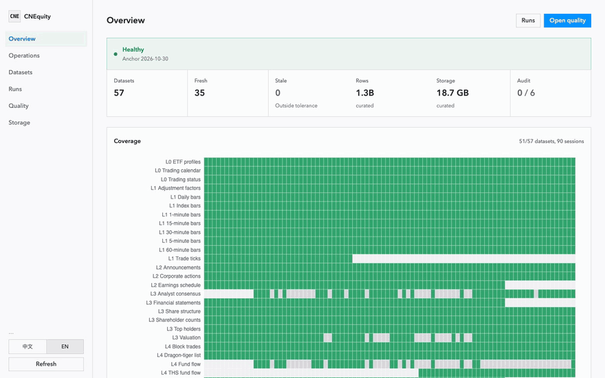
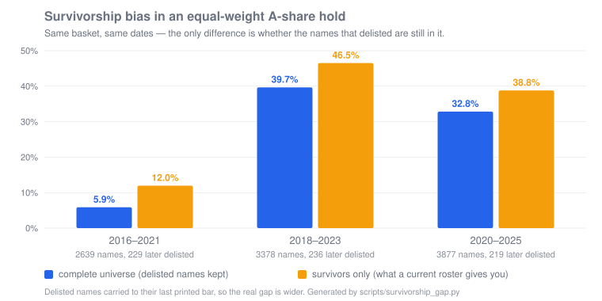
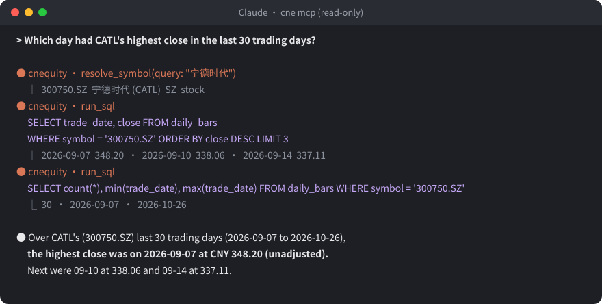

<div align="center">
  
  <h1>CNEquity · A local data foundation for China-market research</h1>
  <p><strong>Collect once, keep it current, and research from the same traceable data.</strong></p>
<p>No registration or token · Adjustment and PIT built in · Delisted stocks kept · Row-level provenance · MCP-native</p>

CNEquity is an open-source local data lake for China A-share (AShare / AStock) stock research. It turns stock prices, financial statements, futures, corporate events and capital-flow data into a local Parquet lake, with incremental ingestion, resumable batches, quality checks and consistent queries for quant research, backtesting and AI agents (via MCP).

[](https://github.com/rootSunc/CNEquity/actions/workflows/ci.yml)
[](https://pypi.org/project/cnequity/)
[](docs/en/getting-started/installation.md)
[](LICENSE)
[](https://pypistats.org/packages/cnequity)
[](https://github.com/rootSunc/CNEquity/stargazers)
[](https://glama.ai/mcp/servers/rootSunc/CNEquity)

[中文](README.md) · [Documentation](https://rootsunc.github.io/CNEquity/en/) · [Dataset catalog](docs/en/datasets/catalog.md) · [Changelog](CHANGELOG.md)
</div>



*A real recording of the `cne serve` dashboard.*

## Why CNEquity

- **Spend less time rebuilding ingestion.** Normalize symbols and columns once, track incremental windows, and resume failed work without discarding successful batches. There are 22 source-probe routes; costly endpoints require explicit selection.
- **Make research assumptions explicit.** Store raw prices separately from adjustment factors; preserve delisted identities; distinguish strict point-in-time evidence from reconstructed history.
- **Keep provenance and versions.** Rows carry `source`, `data_version` and `fetched_at`; immutable generations and research snapshots support later inspection.
- **Own the storage.** Query open Parquet files through Python, DuckDB, Polars, the dashboard and a read-only MCP server.

How it differs from common data tools (full write-up in the [comparison](docs/en/architecture/comparison.md)):

| | AKShare | Tushare Pro | Baostock | CNEquity |
|---|---|---|---|---|
| Account and token | Not needed | Registration + token, unlocked by points | Not needed, anonymous login | Not needed for basic collection |
| Storage and increments | Caller's job | Caller's job | Caller's job | Local Parquet with built-in increments and resume |
| Delisted stocks and PIT financials | Depends on the interface | Depends on the interface | Partly provided | Delisted stocks kept; financials strictly PIT by announcement date |
| Row-level provenance | None | None | None | Every row carries source, version and fetch time |
| Use by AI | Wrap it yourself | Wrap it yourself | Wrap it yourself | Read-only via `cne mcp` |

**Survivorship bias: today's roster is not a historical universe.**

The same equal-weight buy-and-hold strategy over the same dates produces a different result when stocks that later delisted are omitted. This historical sample compares the two universe definitions:



*This historical sample illustrates universe selection. Its returns and stock counts do not describe current lake coverage or future investment performance. Delisted names are valued at their last available bar; see the [universe profiles](docs/en/reference/universe-profiles.md) for evidence limits.*

CNEquity retains delisted identities and makes adjustment, historical membership and PIT semantics part of the query contract.

## Quick start

Requires Python 3.10+ on macOS, Linux or Windows. No account or token needed. The CLI and dashboard speak English and Chinese and follow your system language; `export CNE_LANG=en` pins English.

**① Try it in a minute.** Fetch the last 30 trading days for 5 stocks from live sources into a separate directory that never touches your real lake:

```bash
pip install cnequity
cne init --profile demo   # about a minute; prints the bars, a sample query and the command to hand it to an AI agent
cne serve --config configs/cnequity.demo.toml   # open the dashboard shown above
```

**② Let an AI agent query A-shares.** Connect the lake read-only to Claude, ChatGPT, Codex, Gemini CLI, Cursor, VS Code or any other MCP client (give `--config` as an absolute path). With Claude Code:

```bash
claude mcp add cnequity -- cne mcp --config /abs/path/to/configs/cnequity.demo.toml
```

See the [MCP guide](docs/en/reference/mcp.md#connecting-clients) for every client; ChatGPT only reaches public URLs, so it connects through `cne mcp --http --token` and a tunnel. Then ask: "Which day had CATL's highest close in the last 30 trading days?"



*Real MCP tool calls and results on the demo lake (2026-10-26); closes are unadjusted.*

**③ Build the full lake.** Every Shanghai, Shenzhen and Beijing A-share, last 3 years:

```bash
cne init     # the first run can take hours; if it stops, run it again and nothing already downloaded is fetched twice
             # a few-second network preflight runs first; a failure in a non-critical step such as corporate actions does not stop the build, and the summary lists what is left
cne check    # confirm the data is complete and usable
```

```python
from cnequity.query import load

bars = load("daily_bars", symbols=["600519.SH"])
print(bars.tail())
```

Then run `cne run daily` once a day to stay current. For longer history, or what `init` does step by step, see the [initialization guide](docs/en/getting-started/initialization.md).

## What can you research?

| Question | Data and example | Check first |
|---|---|---|
| Returns across dividends and splits | `daily_bars` + `adj_factors` · [adjustment recipe](docs/en/recipes/research-baseline.md) | Use `adjust="hfq"` and `strict_adj=True` |
| Financial facts visible on a rebalance date | `financial_statement_items` · [PIT recipe](docs/en/recipes/pit-rebalance.md) | Explicit `as_of` and `pit_mode="strict"`; backfilled history is not historical observation |
| Historical universes and pre-delisting prices | `instruments`, `trading_status`, `delisting_events` · [profiles](docs/en/reference/universe-profiles.md) | Validate ST, delisting and price coverage |
| Valuation, flows and sector rotation | Valuation, capital and structure datasets · [query guide](docs/en/datasets/query-guide.md) | Distinguish backfillable history from snapshots collected over time |
| Futures curves, option chains and Greeks | Contract-level prices and derived datasets · [derivatives](docs/en/recipes/derivatives.md) | Opt in; verify exchange coverage and lifecycle evidence |

The same lake reads from Python, SQL and MCP: `load()` applies adjustment, PIT and universe semantics, `scan()` returns a raw LazyFrame, and `cne query --sql` runs DuckDB SQL. See the [Python API](docs/en/reference/python-api.md) and the [query guide](docs/en/datasets/query-guide.md).

## Data coverage

The current development tree registers **55 datasets: 47 curated + 8 derived**, organized into L0–L9. See the [catalog](docs/en/datasets/catalog.md) and [source limitations](docs/en/datasets/sources.md).

| Tier | Research use | Representative datasets |
|---|---|---|
| L0 | Reference | Instruments, trading calendar, trading status |
| L1 | Market data | Daily and index bars, adjustment factors, optional minutes and trade snapshots, delisting events |
| L2 | Corporate events | Actions, announcement index, disclosure schedule |
| L3 | Fundamentals | Financials, valuations, share structure, holders, consensus |
| L4 | Capital and flows | Northbound, margin trading, dragon-tiger lists, block trades, fund flows |
| L5 | Industry structure | Index constituents, industry and sector membership, industry index |
| L6 | Macro | Indicators and market breadth |
| L7 | News and rotation | News, wires, sentiment, rankings, sector prices and flows |
| L8 | Risk and regulation | Share unlocks and regulatory events |
| L9 | Derivatives | Futures and options contracts, contract bars, continuous futures, Greeks and minutes |

Minutes, trade snapshots and futures/options are disabled by default. Check each source's historical horizon and actual coverage after opting in. [Best-effort](docs/en/datasets/catalog.md#support-levels) datasets such as money flow, news and popularity ranks are off by default too; list them in `[datasets] best_effort` to collect them.

<summary>Registered primary and backup sources (actual routing and history limits are in the catalog)</summary>

| Dataset | Tier | Registered primary | Registered backup |
|---|---|---|---|
| `instruments` | L0 | tdx_protocol | baostock |
| `etf_profiles` | L0 | exchange | — |
| `trading_calendar` | L0 | tdx_protocol | exchange |
| `trading_status` | L0 | exchange | eastmoney |
| `adj_factors` | L1 | sina | baostock |
| `daily_bars` | L1 | tdx_protocol | eastmoney |
| `delisting_events` | L1 | derived | — |
| `index_bars` | L1 | tdx_protocol | eastmoney |
| `minute_bars` | L1 | tdx_protocol | — |
| `minute_bars_5m` | L1 | tdx_protocol | — |
| `minute_bars_15m` | L1 | derived | — |
| `minute_bars_30m` | L1 | derived | — |
| `minute_bars_60m` | L1 | derived | — |
| `trade_ticks` | L1 | tdx_protocol | — |
| `announcement_index` | L2 | cninfo | — |
| `corporate_actions` | L2 | tdx_protocol | eastmoney |
| `earnings_disclosure_schedule` | L2 | eastmoney | — |
| `analyst_consensus` | L3 | eastmoney | — |
| `financial_statement_items` | L3 | eastmoney | tdx_fin |
| `share_structure` | L3 | eastmoney | tdx_protocol |
| `shareholder_counts` | L3 | eastmoney | — |
| `top_holders` | L3 | eastmoney | — |
| `valuation_metrics` | L3 | eastmoney | — |
| `block_trades` | L4 | eastmoney | exchange |
| `dragon_tiger` | L4 | eastmoney | exchange |
| `fund_flow` | L4 | eastmoney | — |
| `fund_flow_ths` | L4 | ths | — |
| `institutional_holdings` | L4 | eastmoney | — |
| `margin_trading` | L4 | exchange | — |
| `northbound_flows` | L4 | eastmoney | — |
| `northbound_holdings` | L4 | eastmoney | — |
| `index_constituents` | L5 | exchange | eastmoney |
| `industry_index` | L5 | derived | — |
| `industry_members` | L5 | eastmoney | — |
| `sector_members` | L5 | eastmoney | — |
| `macro_indicators` | L6 | eastmoney | pboc |
| `market_breadth` | L6 | derived | — |
| `economic_calendar` | L7 | eastmoney | — |
| `flash_news_wire` | L7 | eastmoney | — |
| `hot_rank` | L7 | eastmoney | — |
| `news_headlines` | L7 | eastmoney | — |
| `sector_bars` | L7 | ths | — |
| `sector_fund_flow` | L7 | eastmoney | — |
| `sector_fund_flow_ths` | L7 | ths | — |
| `sentiment_scores` | L7 | derived | eastmoney |
| `regulatory_events` | L8 | cninfo | — |
| `share_unlock_schedule` | L8 | eastmoney | — |
| `commodity_bars` | L9 | sina | eastmoney |
| `futures_bars` | L9 | futures_exchange | — |
| `futures_continuous` | L9 | derived | — |
| `futures_contracts` | L9 | futures_exchange | — |
| `futures_minute_bars` | L9 | sina | — |
| `option_bars` | L9 | futures_exchange | — |
| `option_contracts` | L9 | futures_exchange | — |
| `option_greeks` | L9 | derived | — |

Registered sources are dataset metadata; the daily tip, historical backfill and explicit repairs may take different routes. Read them together with the [source notes](docs/en/datasets/sources.md).

</details>

## Architecture


Adapters and batch orchestration collect data into staging; validated batches become curated or derived data. Quality checks, Python and SQL queries, the dashboard and MCP consume published data. The diagram explains responsibilities; see the [data flow](docs/en/architecture/data-flow.md) and [catalog](docs/en/datasets/catalog.md) for current source protocols and enabled datasets.

## Daily updates and upgrades

```bash
cne schedule install   # install a daily job for the current user (macOS / Linux / Windows)
cne run daily          # or run this yourself once a day
cne check              # acceptance; exits non-zero on gaps or quality errors
```

To upgrade: `pip install -U cnequity`, then `cne config upgrade` and `cne migrate` (preview first, then add `--apply`). Scheduling, the operations page and failure follow-up are in the [runbook](docs/en/operations/runbook.md); scope and resume in [initialization](docs/en/getting-started/initialization.md). The full documentation is available in [English](https://rootsunc.github.io/CNEquity/en/) and [Chinese](https://rootsunc.github.io/CNEquity/).

## Fit and limits

CNEquity fits repeated historical research, ongoing collection and self-hosted data operations. A direct source call is lighter for an occasional quote. Existing research and trading platforms can consume the lake; see [choosing a data workflow](docs/en/architecture/overview.md). How it differs from and works alongside AKShare, Tushare and Baostock: [comparison](docs/en/architecture/comparison.md).

- The project is in **0.x development**. Repository documentation describes the current tree; the stable PyPI release may lag. Check `cne --version` and the [changelog](CHANGELOG.md).
- Public-source connectivity, retention and publication schedules vary. Basic collection needs no token; some supplemental sources require your own credentials and permissions.
- Fresh data does not establish complete historical coverage. Strict PIT may return no rows; strict universe queries may reject insufficient evidence.
- CNEquity supplies data infrastructure, not a backtesting engine, trading signals or order execution. Code is [Apache-2.0](LICENSE); upstream data has [separate terms](docs/en/legal-and-data-sources.md). No data lake is distributed with the repository.

## Documentation and contributions

| Task | Read |
|---|---|
| Install and get a result | [Installation](docs/en/getting-started/installation.md) · [Quickstart](docs/en/getting-started/quickstart.md) |
| FAQ | [Free A-share historical data](docs/en/guides/free-a-share-data.md) · [Avoiding look-ahead bias](docs/en/guides/avoid-look-ahead-bias.md) · [Ask AI about A-shares](docs/en/guides/ai-query-a-shares.md) · [AKShare, Tushare or Baostock](docs/en/architecture/comparison.md) |
| Understand the data | [Catalog](docs/en/datasets/catalog.md) · [Schemas](docs/en/datasets/schema.md) · [Recipes](docs/en/recipes/README.md) |
| Find a command | [CLI](docs/en/reference/cli.md) · [Options](docs/en/reference/cli-options.md) · [Network/write effects](docs/en/reference/cli-surface.md) |
| Operate the lake | [Runbook](docs/en/operations/runbook.md) · [Fetch policy](docs/en/operations/fetch-policy.md) · [Troubleshooting](docs/en/operations/troubleshooting.md) |
| Product direction and feedback | [Product overview](docs/en/architecture/overview.md) · [Upgrades and feedback](docs/en/getting-started/installation.md#upgrades-and-compatibility) |

[Issues](https://github.com/rootSunc/CNEquity/issues) with minimal reproductions, documentation fixes and adapter PRs are welcome. Cite [CITATION.cff](CITATION.cff) for research; report vulnerabilities privately using the [security policy](SECURITY.md).

**Useful to you? [Star CNEquity](https://github.com/rootSunc/CNEquity), or share it with someone maintaining China-market data.**
