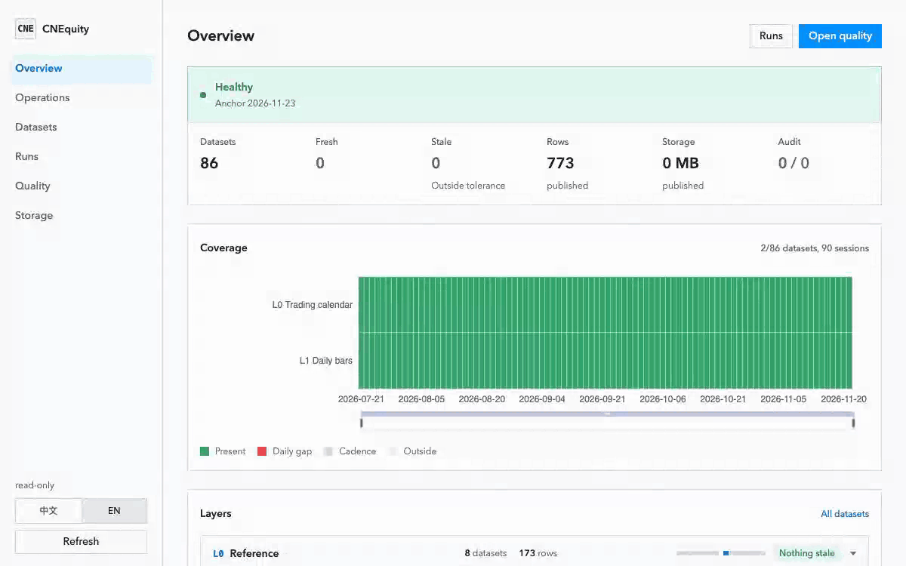
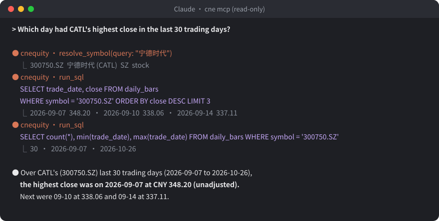
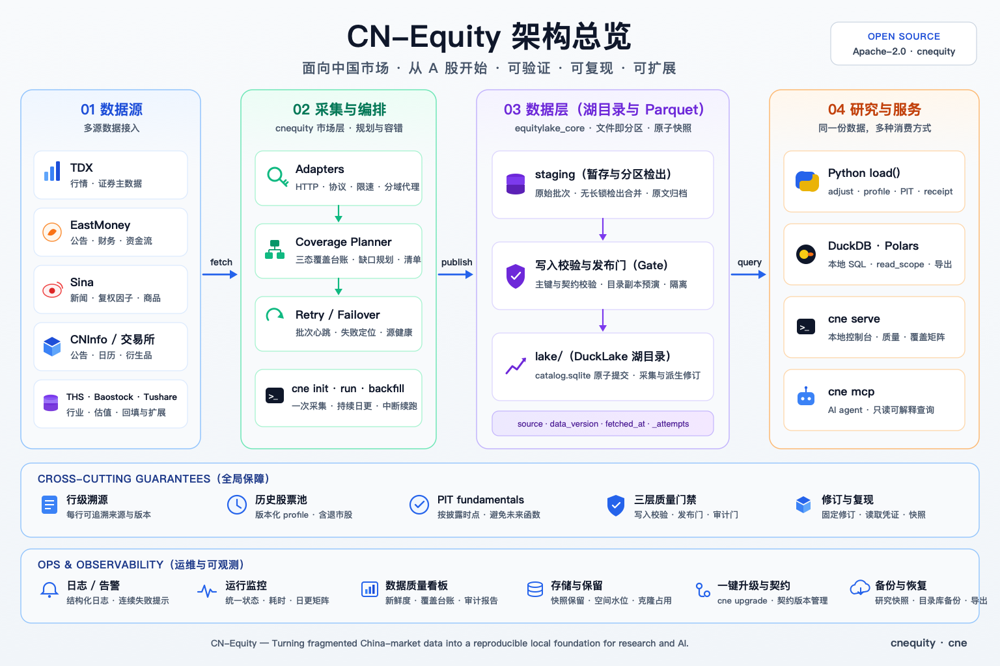
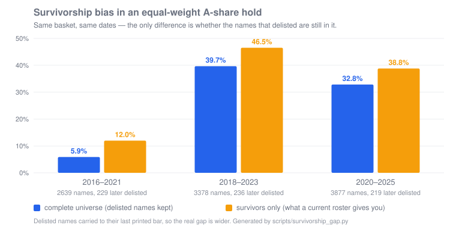

<div align="center">
  
  <h1>CNEquity · A local data foundation for China-market research</h1>
  <p>No registration or token · Adjustment and PIT built in · Delisted stocks kept · Row-level provenance · MCP-native</p>

CNEquity is an open-source local data lake for China A-share market data: Shanghai, Shenzhen, and Beijing prices, corporate events, financials, and futures/options data, for quant research, quantitative trading, and backtesting. 86 datasets publish atomically into a DuckLake catalog over local Parquet, with coverage-ledger incremental resume and MCP so an AI agent can query A-shares directly.

[](https://github.com/rootSunc/CNEquity/actions/workflows/ci.yml)
[](https://pypi.org/project/cnequity/)
[](docs/en/getting-started/installation.md)
[](LICENSE)
[](https://pypistats.org/packages/cnequity)
[](https://github.com/rootSunc/CNEquity/stargazers)
[](https://glama.ai/mcp/servers/rootSunc/CNEquity)

[中文](README.md) · [Documentation](https://rootsunc.github.io/CNEquity/en/) · [Dataset catalog](docs/en/datasets/catalog.md) · [Changelog](CHANGELOG.md) · [Releases](https://github.com/rootSunc/CNEquity/releases)
</div>



*A real recording of the `cne serve` dashboard.*

## Why CNEquity

How it differs from common data tools (see [Design](docs/en/architecture/overview.md#scope) for scope and trade-offs):

| | AKShare | Tushare Pro | Baostock | CNEquity |
|---|---|---|---|---|
| Account and token | Not needed | Registration + token, unlocked by points | Not needed, anonymous login | Not needed for basic collection; optional paid sources such as Tushare for backfill |
| Storage and increments | Caller's job | Caller's job | Caller's job | DuckLake catalog + partition-per-file Parquet, with gap planning and resume via the coverage ledger |
| Delisted stocks and PIT financials | Depends on the interface | Depends on the interface | Partly provided | Versioned historical universes keep delisted stocks; financials strictly PIT by disclosure date |
| Row-level provenance and revisions | None | None | None | Every row carries `source`, `data_version`, and `fetched_at`; pin revisions and capture read receipts |
| Use by AI | Wrap it yourself | Wrap it yourself | Wrap it yourself | Read-only via `cne mcp` |

## Quick start

Requires Python 3.11+ (with DuckDB 2.0+ on macOS, Linux, or Windows). No account or token needed for basic collection. On a machine with constrained memory or disk, see [Machines with little memory or disk](docs/en/getting-started/configuration.md#small-machines) first.

**① Try it in a minute.** Fetch the last 30 trading days for 5 stocks from live sources into a separate directory that never touches your real lake (or run `cne init --profile sample` for an offline synthetic sample):

```bash
pip install cnequity
cne init --profile demo   # about a minute; prints the bars, a sample query and the command to hand it to an AI agent
cne serve --config configs/cnequity.demo.toml   # open the dashboard shown above
```

**② Let an AI agent query A-shares.** Connect the lake read-only to Claude, ChatGPT, Codex, Gemini CLI, Cursor, VS Code, or any other MCP client (give `--config` as an absolute path). With Claude Code:

```bash
claude mcp add cnequity -- cne mcp --config /abs/path/to/configs/cnequity.demo.toml
```

See the [MCP guide](docs/en/reference/mcp.md) for every client; ChatGPT only reaches public URLs, so it connects through `cne mcp --http --token` and a tunnel. Then ask: "Which day had CATL's highest close in the last 30 trading days?"



*Real MCP tool calls and results on the demo lake; closes are unadjusted.*

**③ Build the full lake.** Every Shanghai, Shenzhen, and Beijing A-share, last 3 years:

```bash
cne init     # the first run can take hours; if it stops, run it again and nothing already downloaded is fetched twice
cne check    # confirm the data is complete and usable
```

```python
from cnequity.query import load

bars = load("daily_bars", symbols=["600519.SH"])
print(bars.tail())
```

Then run `cne run daily` once a day to stay current. For deeper history (`cne init --profile full`) or collection scopes and resume behavior, see the [quickstart](docs/en/getting-started/quickstart.md#init-scope).

## What can you research?

| Question | Data and example |
|---|---|
| Returns across dividends and splits | `daily_bars` + `adj_factors` · [prices and adjustment](docs/en/datasets/query-guide.md#prices-and-universe) |
| Financial facts visible on a rebalance date | `financial_statement_items` · [point-in-time financials](docs/en/datasets/query-guide.md#pit) |
| Historical universes and pre-delisting prices | `instruments`, `trading_status`, `delisting_events` · [historical universes and `profile`](docs/en/datasets/query-guide.md#prices-and-universe) |
| Valuation, flows, and sector rotation | `valuation_metrics`, capital, and structure datasets · [query guide](docs/en/datasets/query-guide.md) |
| Futures curves, option chains, and Greeks | Contract-level prices and derived datasets · [intraday and derivatives](docs/en/datasets/query-guide.md#intraday-and-derivatives) |

## Data coverage

**86 datasets** (78 collected, 8 derived), organized into L0–L9. Support levels, keys, history starts, and sources are in the [dataset catalog](docs/en/datasets/catalog.md) and [fields and units](docs/en/datasets/schema.md).

| Tier | Research use | Representative datasets |
|---|---|---|
| L0 | Reference | Instruments, trading calendar, trading status, name history, convertible bonds, executives |
| L1 | Market data | Daily, index, and convertible-bond bars, price limits, adjustment factors, optional minutes and trade snapshots, delisting events |
| L2 | Corporate events | Corporate actions, announcement index, earnings forecasts and disclosure schedule, insider trades, share repurchases, bond calls and conversions |
| L3 | Fundamentals | Financials, business segments, valuations, share structure, holder counts and top holders, executive pay, consensus and broker forecasts |
| L4 | Capital and flows | Northbound flows and top-10 turnover, margin trading, dragon-tiger lists, hot-money rosters and trades, limit-up ladders, chip distribution, block trades, fund flows |
| L5 | Industry structure | Index constituents, industry and sector membership, industry index |
| L6 | Macro | Macro indicators, market breadth |
| L7 | News and rotation | News, wires, investor Q&A, sentiment, popularity and strongest sectors, sector prices and flows, economic calendar |
| L8 | Risk and regulation | Share pledges, share unlocks, regulatory events |
| L9 | Derivatives | Futures and options contracts, contract bars, commodity bars, member positions, continuous futures, Greeks, minute bars |

Minutes, trade snapshots, futures/options, and [best-effort](docs/en/datasets/catalog.md#coverage) datasets such as money flow, news, and popularity ranks are off by default. Turn them on when you need them.

## Architecture



The system is split into the market-neutral lake engine `equitylake_core` (the DuckLake catalog `lake/catalog.sqlite`, partition-per-file Parquet storage, lock-free partition checkout and merge, the coverage ledger `_attempts`, and gap planning) and the China-market package `cnequity` (L0–L9 contracts, source adapters, three-tier quality gates, research query semantics, and the CLI). External tools that read raw Parquet files directly can export standalone files with `cne storage export`. See the [design](docs/en/architecture/overview.md) for details.

## Survivorship bias

**Today's roster is not a historical universe.** Select the universe as of the research date in `load()` with a versioned universe profile (`profile`, such as `cn_a_sh_sz_research_v1`) so stocks that were listed at the time and later delisted are not dropped.



## Daily updates and upgrades

```bash
cne schedule install   # install a daily job for the current user (macOS / Linux / Windows)
cne run daily          # or run this yourself once a day
cne check              # acceptance; exits non-zero on gaps or quality errors
```

To upgrade: `pip install -U cnequity`, then run `cne upgrade` (preview first, then add `cne upgrade --apply` to migrate to the lake catalog in one step; fully expanded configs can also run `cne config upgrade`). From 0.25.0 onward, the lake catalog is the sole storage engine, and **the 0.25.x series is the last that upgrades lakes built by 0.24.0 or earlier**. Back up your data directory before upgrading and read [Upgrade to 0.25.0](docs/en/getting-started/upgrade-0.25.md). Scheduling, the operations page, disk usage (`cne storage usage`), and failure follow-up are in [daily updates](docs/en/operations/runbook.md).

## Fit and limits

CNEquity fits ongoing history, repeated queries, and self-hosted data.

The project is in **0.x**, with no backtesting engine or order execution. Code is [Apache-2.0](LICENSE); upstream data has [separate terms](docs/en/legal-and-data-sources.md). No data lake is distributed with the repository.

## Documentation and contributions

| Task | Read |
|---|---|
| Install, run a first query, or upgrade an existing lake | [Install and upgrade](docs/en/getting-started/installation.md) · [Upgrade to 0.25.0](docs/en/getting-started/upgrade-0.25.md) · [Quickstart](docs/en/getting-started/quickstart.md) |
| Understand the data and semantics | [Dataset catalog](docs/en/datasets/catalog.md) · [Fields and units](docs/en/datasets/schema.md) · [Query and research](docs/en/datasets/query-guide.md) |
| Query through Python, SQL, or MCP | [Python API](docs/en/reference/python-api.md) · [MCP](docs/en/reference/mcp.md) · [Query guide](docs/en/datasets/query-guide.md) |
| Find commands, config keys, and side effects | [Network and write inventory](docs/en/reference/cli-surface.md) · [Configuration](docs/en/getting-started/configuration.md) |
| Operate the lake | [Daily updates](docs/en/operations/runbook.md) · [Troubleshooting](docs/en/operations/troubleshooting.md) |
| Product design and feedback | [Design](docs/en/architecture/overview.md) · [Upgrades and compatibility](docs/en/getting-started/installation.md#upgrades-and-compatibility) |

[Issues](https://github.com/rootSunc/CNEquity/issues) with minimal reproductions, documentation fixes, and adapter PRs are welcome. Cite [CITATION.cff](CITATION.cff) for research; report vulnerabilities privately using the [security policy](SECURITY.md).

**Useful to you? [Star CNEquity](https://github.com/rootSunc/CNEquity), or share it with someone maintaining China-market data.**
