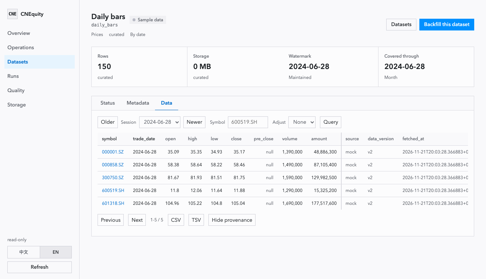

<div align="center">
  
  <h1>CNEquity · A local data foundation for China-market research</h1>
  <p>Local Parquet · Incremental updates · Price adjustment and point-in-time queries · Row-level provenance · MCP-native</p>

CNEquity is a local China-market data lake for quantitative research. It collects prices, financial statements, corporate events, and flows into local Parquet with incremental updates and row-level provenance. Query the lake through Python, SQL, or MCP. Historical universes, price adjustment, and point-in-time reads have explicit data requirements and coverage limits.

[](https://github.com/rootSunc/CNEquity/actions/workflows/ci.yml)
[](https://pypi.org/project/cnequity/)
[](docs/en/getting-started/installation.md)
[](LICENSE)
[](https://pypistats.org/packages/cnequity)
[](https://github.com/rootSunc/CNEquity/stargazers)
[](https://glama.ai/mcp/servers/rootSunc/CNEquity)

[中文](README.md) · [Documentation](https://rootsunc.github.io/CNEquity/en/) · [Dataset catalog](docs/en/datasets/catalog.md) · [Changelog](CHANGELOG.md) · [Releases](https://github.com/rootSunc/CNEquity/releases)
</div>



*The `cne serve` dashboard with synthetic prices from the offline sample.*

## Why CNEquity

| Capability | In CNEquity |
|---|---|
| Accounts and tokens | Basic collection requires no paid-source credentials, while some datasets need additional sources or credentials |
| Storage and updates | Local Parquet with incremental updates and resume |
| Historical universes and point-in-time financials | Read dated evidence, with coverage determined by the source and local collection |
| Row-level provenance | Verify the source through `source`, `data_version`, and `fetched_at` |
| Research and AI queries | Python, SQL, and read-only MCP |

## Quick start

Use Python 3.11 or newer on macOS, Linux, or Windows.

**① Try it offline.** Run these commands in an empty working directory. The sample uses synthetic data and requires no connection to market-data providers.

```bash
python -m pip install cnequity
cne init --profile sample
cne query --config configs/cnequity.sample.toml --sql "SELECT symbol, trade_date, close, source FROM daily_bars ORDER BY trade_date DESC LIMIT 5"
cne serve --read-only --config configs/cnequity.sample.toml
```

**② Query the sample with AI.** In Claude Code, pass the absolute path to your configuration file to the read-only MCP server.

```bash
claude mcp add cnequity -- cne mcp --config /abs/path/to/configs/cnequity.sample.toml
```

Try asking “What is the latest date in the sample daily bars, and what is their source?” For other clients, see [Connect MCP](https://rootsunc.github.io/CNEquity/en/reference/mcp/).

**③ Collect real data.** Run `cne init --profile demo` to collect daily bars for a few symbols into a separate demo lake. Run `cne init` for about three years of baseline data across the configured universe, then use `cne check` to verify it. See the [quickstart](docs/en/getting-started/quickstart.md) for deeper history, configuration, and resume behavior.

```python
from cnequity.query import load

bars = load("daily_bars", symbols=["600519.SH"])
print(bars.tail())
```

## What can you research?

| Question | Data and example |
|---|---|
| Returns across dividends and splits | `daily_bars` + `adj_factors` · [prices and adjustment](https://rootsunc.github.io/CNEquity/en/datasets/query-guide/#prices-and-universe) |
| Financial facts available on a rebalance date | `financial_statement_items` · [point-in-time financials](https://rootsunc.github.io/CNEquity/en/datasets/query-guide/#pit) |
| Historical universes and pre-delisting prices | `instruments`, `trading_status`, `delisting_events` · [historical universes](https://rootsunc.github.io/CNEquity/en/datasets/query-guide/#prices-and-universe) |
| Valuation, flows, and sector rotation | `valuation_metrics`, capital, and structure datasets · [dataset catalog](docs/en/datasets/catalog.md) |
| Futures curves, option chains, and Greeks | Contract-level prices and derived datasets · [intraday and derivatives](https://rootsunc.github.io/CNEquity/en/datasets/query-guide/#intraday-and-derivatives) |

## Data coverage

Datasets are grouped by research purpose from L0 to L9. See the [dataset catalog](docs/en/datasets/catalog.md) for support levels, sources, and historical limits, and [fields and units](docs/en/datasets/schema.md) for column definitions.

| Tier | Research use | Representative datasets |
|---|---|---|
| L0 | Reference | Instruments, trading calendar, trading status |
| L1 | Market data | Daily and index bars, adjustment factors, minute bars and trade snapshots, delisting events |
| L2 | Corporate events | Corporate actions, announcement index, disclosure schedule |
| L3 | Fundamentals | Financials, valuations, share structure, holders, consensus |
| L4 | Capital and flows | Northbound flows, margin trading, dragon-tiger lists, block trades, fund flows |
| L5 | Industry structure | Index constituents, industry and sector membership, industry indices |
| L6 | Macro | Macro indicators, market breadth |
| L7 | News and rotation | News, wires, sentiment, rankings, sector prices and flows |
| L8 | Risk and regulation | Share unlocks, regulatory events |
| L9 | Derivatives | Futures and options contracts, contract bars, continuous futures, Greeks, minute bars |

## Architecture


See the [design](docs/en/architecture/overview.md) for the catalog, publishing, coverage planning, quality gates, and reproducibility.

## Survivorship bias

**Select the universe as of the research date.** Filtering history with today's listings drops stocks that were listed at the time and later delisted. Historical listing, delisting, and special-treatment status depend on dated evidence. See [prices and historical universes](https://rootsunc.github.io/CNEquity/en/datasets/query-guide/#prices-and-universe).

## Daily updates and upgrades

```bash
cne run daily
cne status --datasets
cne check
```

See [daily updates](docs/en/operations/runbook.md) for scheduling, coverage checks, and backfills, and [troubleshooting](docs/en/operations/troubleshooting.md) to locate problems by symptom. Before upgrading, review the migration and backup requirements for the target version in [install and upgrade](docs/en/getting-started/installation.md).

## Fit and limits

CNEquity fits ongoing historical collection, repeated queries, and self-hosted data. The software is [Apache-2.0](LICENSE). Upstream data is subject to its providers' terms. See [license, sources, and citation](docs/en/legal-and-data-sources.md).

## Documentation and contributions

| Task | Read |
|---|---|
| Install and run a first query | [Install and upgrade](docs/en/getting-started/installation.md) · [Quickstart](docs/en/getting-started/quickstart.md) |
| Find datasets and verify coverage | [Dataset catalog](docs/en/datasets/catalog.md) · [Fields and units](docs/en/datasets/schema.md) |
| Understand the design | [Design](docs/en/architecture/overview.md) |
| Query through Python, SQL, or MCP | [Query and research](docs/en/datasets/query-guide.md) · [Python API](docs/en/reference/python-api.md) · [MCP](docs/en/reference/mcp.md) |
| Check command, network, and write behavior | [CLI side-effect inventory](docs/en/reference/cli-surface.md) |
| Configure, schedule, and recover jobs | [Configuration](docs/en/getting-started/configuration.md) · [Daily updates](docs/en/operations/runbook.md) · [Troubleshooting](docs/en/operations/troubleshooting.md) |
| Report an issue or vulnerability | [Support](.github/SUPPORT.md) · [Security reporting](SECURITY.md) |

When reporting a problem, include your version, command, and a minimal reproduction with credentials and personal paths removed. For research citations, see [CITATION.cff](CITATION.cff).
