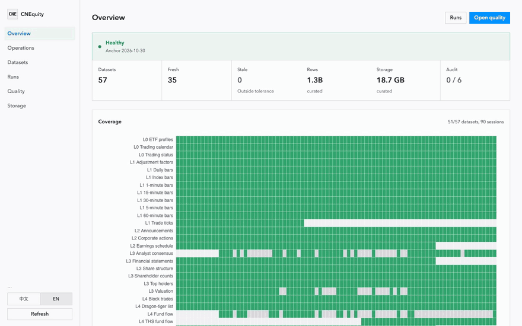
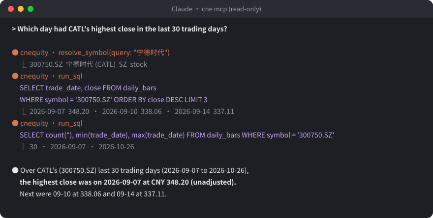
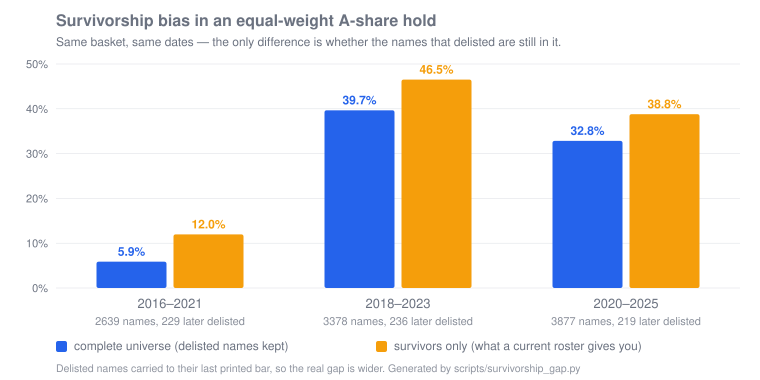

<div align="center">
  
  <h1>CNEquity · A local data foundation for China-market research</h1>
<p>No registration or token · Adjustment and PIT built in · Delisted stocks kept · Row-level provenance · MCP-native</p>

CNEquity is an open-source local data lake for China A-share stock market data: Shanghai and Shenzhen prices, stock data, financials and futures data, for quant research, quantitative trading and backtesting. 57 datasets land in local Parquet, with incremental resume, and MCP so an AI can query A-shares directly.

[](https://github.com/rootSunc/CNEquity/actions/workflows/ci.yml)
[](https://pypi.org/project/cnequity/)
[](docs/en/getting-started/installation.md)
[](LICENSE)
[](https://pypistats.org/packages/cnequity)
[](https://github.com/rootSunc/CNEquity/stargazers)
[](https://glama.ai/mcp/servers/rootSunc/CNEquity)

[中文](README.md) · [Documentation](https://rootsunc.github.io/CNEquity/en/) · [Dataset catalog](docs/en/datasets/catalog.md) · [Changelog](CHANGELOG.md)
</div>



*A real recording of the `cne serve` dashboard.*

## Why CNEquity

How it differs from common data tools (full write-up in the [comparison](docs/en/architecture/comparison.md)):

| | AKShare | Tushare Pro | Baostock | CNEquity |
|---|---|---|---|---|
| Account and token | Not needed | Registration + token, unlocked by points | Not needed, anonymous login | Not needed for basic collection |
| Storage and increments | Caller's job | Caller's job | Caller's job | Local Parquet with built-in increments and resume |
| Delisted stocks and PIT financials | Depends on the interface | Depends on the interface | Partly provided | Delisted stocks kept; financials strictly PIT by announcement date |
| Row-level provenance | None | None | None | Every row carries source, version and fetch time |
| Use by AI | Wrap it yourself | Wrap it yourself | Wrap it yourself | Read-only via `cne mcp` |

## Quick start

Requires Python 3.10+ on macOS, Linux or Windows. No account or token needed.

**① Try it in a minute.** Fetch the last 30 trading days for 5 stocks from live sources into a separate directory that never touches your real lake:

```bash
pip install cnequity
cne init --profile demo   # about a minute; prints the bars, a sample query and the command to hand it to an AI agent
cne serve --config configs/cnequity.demo.toml   # open the dashboard shown above
```

**② Let an AI agent query A-shares.** Connect the lake read-only to Claude, ChatGPT, Codex, Gemini CLI, Cursor, VS Code or any other MCP client (give `--config` as an absolute path). With Claude Code:

```bash
claude mcp add cnequity -- cne mcp --config /abs/path/to/configs/cnequity.demo.toml
```

See the [MCP guide](docs/en/reference/mcp.md#connecting-clients) for every client; ChatGPT only reaches public URLs, so it connects through `cne mcp --http --token` and a tunnel. Then ask: "Which day had CATL's highest close in the last 30 trading days?"



*Real MCP tool calls and results on the demo lake; closes are unadjusted.*

**③ Build the full lake.** Every Shanghai, Shenzhen and Beijing A-share, last 3 years:

```bash
cne init     # the first run can take hours; if it stops, run it again and nothing already downloaded is fetched twice
             # a few-second network preflight runs first; a failure in a non-critical step such as corporate actions does not stop the build, and the summary lists what is left
cne check    # confirm the data is complete and usable
```

```python
from cnequity.query import load

bars = load("daily_bars", symbols=["600519.SH"])
print(bars.tail())
```

Then run `cne run daily` once a day to stay current. For longer history, or what `init` does step by step, see the [initialization guide](docs/en/getting-started/initialization.md).

## What can you research?

| Question | Data and example |
|---|---|
| Returns across dividends and splits | `daily_bars` + `adj_factors` · [adjustment recipe](docs/en/recipes/research-baseline.md) |
| Financial facts visible on a rebalance date | `financial_statement_items` · [PIT recipe](docs/en/recipes/pit-rebalance.md) |
| Historical universes and pre-delisting prices | `instruments`, `trading_status`, `delisting_events` · [profiles](docs/en/reference/universe-profiles.md) |
| Valuation, flows and sector rotation | Valuation, capital and structure datasets · [query guide](docs/en/datasets/query-guide.md) |
| Futures curves, option chains and Greeks | Contract-level prices and derived datasets · [derivatives](docs/en/recipes/derivatives.md) |

## Data coverage

**57 datasets** (49 curated, 8 derived), organized into L0–L9. Fields, keys, history starts and sources are in the [catalog](docs/en/datasets/catalog.md) and [source notes](docs/en/datasets/sources.md).

| Tier | Research use | Representative datasets |
|---|---|---|
| L0 | Reference | Instruments, trading calendar, trading status |
| L1 | Market data | Daily and index bars, adjustment factors, optional minutes and trade snapshots, delisting events |
| L2 | Corporate events | Actions, announcement index, disclosure schedule |
| L3 | Fundamentals | Financials, valuations, share structure, holders, consensus |
| L4 | Capital and flows | Northbound, margin trading, dragon-tiger lists, block trades, fund flows |
| L5 | Industry structure | Index constituents, industry and sector membership, industry index |
| L6 | Macro | Indicators and market breadth |
| L7 | News and rotation | News, wires, sentiment, rankings, sector prices and flows |
| L8 | Risk and regulation | Share unlocks and regulatory events |
| L9 | Derivatives | Futures and options contracts, contract bars, continuous futures, Greeks and minutes |

Minutes, trade snapshots, futures/options, and [best-effort](docs/en/datasets/catalog.md#support-levels) datasets such as money flow, news and popularity ranks are off by default. Turn them on when you need them.

## Architecture


## Survivorship bias

**Today's roster is not a historical universe.**



## Daily updates and upgrades

```bash
cne schedule install   # install a daily job for the current user (macOS / Linux / Windows)
cne run daily          # or run this yourself once a day
cne check              # acceptance; exits non-zero on gaps or quality errors
```

To upgrade: `pip install -U cnequity`, then `cne config upgrade` and `cne migrate` (preview first, then add `--apply`). Scheduling, the operations page and failure follow-up are in the [runbook](docs/en/operations/runbook.md); scope and resume in [initialization](docs/en/getting-started/initialization.md).

## Fit and limits

CNEquity fits ongoing history, repeated queries and self-hosted data.

The project is in **0.x**, with no backtesting engine or order execution. Code is [Apache-2.0](LICENSE); upstream data has [separate terms](docs/en/legal-and-data-sources.md). No data lake is distributed with the repository.

## Documentation and contributions

| Task | Read |
|---|---|
| Install and get a result | [Installation](docs/en/getting-started/installation.md) · [Quickstart](docs/en/getting-started/quickstart.md) |
| FAQ | [Free A-share historical data](docs/en/guides/free-a-share-data.md) · [Avoiding look-ahead bias](docs/en/guides/avoid-look-ahead-bias.md) · [Ask AI about A-shares](docs/en/guides/ai-query-a-shares.md) · [AKShare, Tushare or Baostock](docs/en/architecture/comparison.md) |
| Understand the data | [Catalog](docs/en/datasets/catalog.md) · [Schemas](docs/en/datasets/schema.md) · [Recipes](docs/en/recipes/README.md) |
| Find a command | [CLI](docs/en/reference/cli.md) · [Options](docs/en/reference/cli-options.md) · [Network/write effects](docs/en/reference/cli-surface.md) |
| Operate the lake | [Runbook](docs/en/operations/runbook.md) · [Fetch policy](docs/en/operations/fetch-policy.md) · [Troubleshooting](docs/en/operations/troubleshooting.md) |
| Product direction and feedback | [Product overview](docs/en/architecture/overview.md) · [Upgrades and feedback](docs/en/getting-started/installation.md#upgrades-and-compatibility) |

[Issues](https://github.com/rootSunc/CNEquity/issues) with minimal reproductions, documentation fixes and adapter PRs are welcome. Cite [CITATION.cff](CITATION.cff) for research; report vulnerabilities privately using the [security policy](SECURITY.md).

**Useful to you? [Star CNEquity](https://github.com/rootSunc/CNEquity), or share it with someone maintaining China-market data.**
