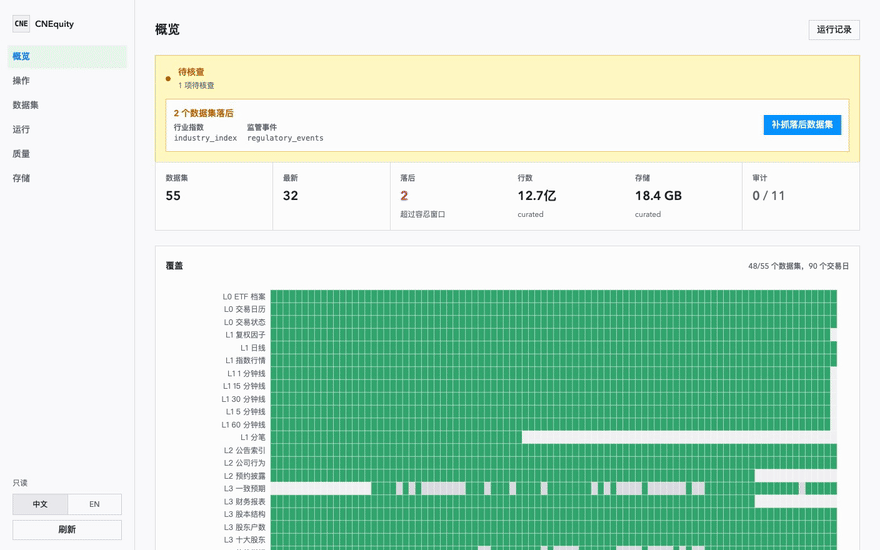
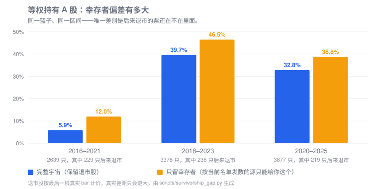
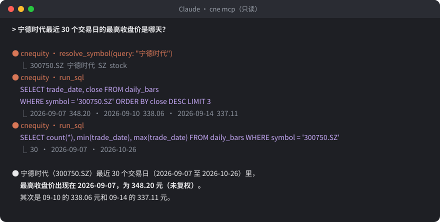

<div align="center">
  
  <h1>CNEquity · 中国市场金融数据湖</h1>
  <p><strong>打破数据垄断，构建属于每个人的本地金融数据集</strong></p>
<p>免注册、免 Token · 复权与 PIT 内置 · 保留退市股 · 行级溯源 · MCP 原生</p>

CNEquity 是开源的中国 A股本地数据湖：将股票行情、财务数据、期货合约、公司事件和资金面等多源数据整理为本地 Parquet，提供增量采集、失败续跑、质量审计与统一查询。适合量化研究与反复回测、长期积累历史股票数据，也可通过 MCP 让 Claude、ChatGPT 等 AI Agent 直接查询 A股。

[](https://github.com/rootSunc/CNEquity/actions/workflows/ci.yml)
[](https://pypi.org/project/cnequity/)
[](docs/zh/getting-started/installation.md)
[](LICENSE)
[](https://github.com/rootSunc/CNEquity/stargazers)
[](https://glama.ai/mcp/servers/rootSunc/CNEquity)

[English](README.en.md) · [完整文档](https://rootsunc.github.io/CNEquity/) · [数据集目录](docs/zh/datasets/catalog.md) · [更新日志](CHANGELOG.md)
</div>



*`cne serve` 控制台真实录屏。*

## 为什么用 CNEquity

- **少写重复的数据工程。** 代码、字段、分区和增量窗口由数据层管理；中断后保留成功批次，按失败范围续跑。22 条源探针路由帮助诊断可达性（高成本端点需显式选择）。
- **把研究口径说清楚。** 原始价与复权因子分开存；历史股票池保留退市身份；财报查询区分严格 PIT 与事后重建。
- **结果有来源，也有版本。** 行级 `source`、`data_version`、`fetched_at` 配合不可变数据版本与研究快照，支持复查和重现。
- **数据留在自己手里。** 开放的 Parquet 文件，通过 Python、DuckDB、Polars、控制台和只读 MCP 消费。

和常用取数工具的区别（完整说明见[对比页](docs/zh/architecture/comparison.md)）：

| | AKShare | Tushare Pro | Baostock | CNEquity |
|---|---|---|---|---|
| 账号与 Token | 不需要 | 注册 + Token，按积分开放 | 不需要，匿名登录 | 基础采集不需要 |
| 数据落盘与增量 | 调用方自己做 | 调用方自己做 | 调用方自己做 | 本地 Parquet，内置增量与续跑 |
| 退市股与 PIT 财报 | 取决于接口 | 取决于接口 | 部分提供 | 保留退市股，财报按公告日严格 PIT |
| 行级溯源 | 无 | 无 | 无 | 每行带来源、版本和抓取时间 |
| 给 AI 用 | 自己封装 | 自己封装 | 自己封装 | `cne mcp` 只读接入 |

**幸存者偏差：今天的名单不能代替历史股票池。**

同一等权买入持有策略、同一时间窗口，仅按今天仍在交易的股票回看过去，会漏掉后来退市的标的。下图用历史样本展示两种股票池得到的结果差异：



*历史样本仅用于说明股票池口径；图中收益和标的数量不代表当前湖覆盖或未来投资表现。退市股按最后一根可用行情计价，因子及退市覆盖限制见[股票池画像](docs/zh/reference/universe-profiles.md)。*

CNEquity 在数据层保留退市身份，并让复权、历史成分和 PIT 口径进入查询契约，避免下游研究在无意中丢掉这些标的。

## 快速开始

需要 Python 3.10+（macOS / Linux / Windows），不需要账号或 token。命令行和控制台支持中英文，默认跟随系统语言，`export CNE_LANG=zh_CN` 可固定为中文。

**① 一分钟试用。** 用真实数据源抓 5 只股票最近 30 个交易日，建在独立目录里，不影响以后的正式湖：

```bash
pip install cnequity
cne init --profile demo   # 约 1 分钟；结束时打印行情表、查询示例和接给 AI 的命令
cne serve --config configs/cnequity.demo.toml   # 在浏览器里打开上面的控制台
```

**② 让 AI 直接查 A 股。** 把湖以只读方式接给 Claude、ChatGPT、Codex、Gemini CLI、Cursor、VS Code 等支持 MCP 的客户端（`--config` 用绝对路径）。以 Claude Code 为例：

```bash
claude mcp add cnequity -- cne mcp --config /abs/path/to/configs/cnequity.demo.toml
```

各家客户端的写法见 [MCP 接入指南](docs/zh/reference/mcp.md#接入各家客户端)；ChatGPT 只接公网网址，用 `cne mcp --http --token` 加隧道接入。然后直接问：「宁德时代最近 30 个交易日的最高收盘价是哪天？」



*真实 MCP 工具调用与返回（2026-10-26）；收盘价为未复权价。*

**③ 建正式湖。** 沪深京全市场、最近 3 年：

```bash
cne init     # 开始建正式湖，支持中断续传
cne check    # 检查数据是否完整、可用
```

```python
from cnequity.query import load

bars = load("daily_bars", symbols=["600519.SH"])
print(bars.tail())
```

之后每天运行一次 `cne run daily` 保持更新。想要更长的历史，或了解 `init` 具体做了什么，见[初始化指南](docs/zh/getting-started/initialization.md)。

## 能用它研究什么

| 你的问题 | 数据与入口 | 需要确认的口径 |
|---|---|---|
| 跨分红、送转后的历史收益 | `daily_bars` + `adj_factors` · [复权示例](docs/zh/recipes/research-baseline.md) | `adjust="hfq"`，研究时开启 `strict_adj=True` |
| 某个调仓日已经知道哪些财报信息 | `financial_statement_items` · [PIT 示例](docs/zh/recipes/pit-rebalance.md) | 显式 `as_of` + `pit_mode="strict"`；新回填不等于当时可见 |
| 历史股票池、退市前行情 | `instruments`、`trading_status`、`delisting_events` · [股票池画像](docs/zh/reference/universe-profiles.md) | 历史 ST、退市和行情覆盖需另行核验 |
| 估值、资金流、行业轮动 | `valuation_metrics`、资金面与结构数据 · [查询指南](docs/zh/datasets/query-guide.md) | 分清可回补历史与启用后积累的快照 |
| 期货期限结构、期权链与 Greeks | 逐合约行情和派生数据 · [衍生品指南](docs/zh/recipes/derivatives.md) | 默认关闭，按交易所、合约生命周期与覆盖证据验收 |

同一份湖可以用 Python、SQL 和 MCP 读取：`load()` 提供复权、PIT 和股票池语义，`scan()` 提供原始 LazyFrame，`cne query --sql` 跑 DuckDB SQL。参数与边界见 [Python API](docs/zh/reference/python-api.md) 和[查询指南](docs/zh/datasets/query-guide.md)。

## 数据范围

当前开发树注册 **55 个数据集：47 个 curated + 8 个 derived**，按用途分为 L0–L9。完整字段、主键、历史起点和来源集中在[数据集目录](docs/zh/datasets/catalog.md)与[数据源说明](docs/zh/datasets/sources.md)。

| 层次 | 研究用途 | 代表数据集 |
|---|---|---|
| L0 | 基础参考 | 证券主数据、交易日历、交易状态 |
| L1 | 行情 | 日线、指数、复权因子、可选分钟线与分笔、退市事件 |
| L2 | 公司事件 | 公司行为、公告索引、业绩披露预约 |
| L3 | 基本面 | 财报、估值、股本、股东、一致预期 |
| L4 | 资金面 | 北向、融资融券、龙虎榜、大宗交易、资金流 |
| L5 | 结构行业 | 指数成分、行业与板块成分、行业指数 |
| L6 | 宏观 | 宏观指标、市场宽度 |
| L7 | 舆情与轮动 | 新闻、快讯、情绪、人气、板块行情与资金流 |
| L8 | 风险合规 | 解禁日程、监管事件 |
| L9 | 衍生品 | 期货与期权合约、逐合约行情、连续合约、Greeks、分钟线 |

分钟线、分笔和期货/期权默认关闭；按需启用后仍须检查来源的历史视野与实际覆盖。

<details>
<summary>展开注册表的主备来源速查（实际路由与历史限制见数据集目录）</summary>

| 数据集 | 层次 | 登记主源 | 登记备源 |
|---|---|---|---|
| `instruments` | L0 | tdx_protocol | baostock |
| `etf_profiles` | L0 | exchange | — |
| `trading_calendar` | L0 | tdx_protocol | exchange |
| `trading_status` | L0 | eastmoney | exchange |
| `adj_factors` | L1 | sina | baostock |
| `daily_bars` | L1 | tdx_protocol | eastmoney |
| `delisting_events` | L1 | derived | — |
| `index_bars` | L1 | tdx_protocol | eastmoney |
| `minute_bars` | L1 | tdx_protocol | — |
| `minute_bars_5m` | L1 | tdx_protocol | — |
| `minute_bars_15m` | L1 | derived | — |
| `minute_bars_30m` | L1 | derived | — |
| `minute_bars_60m` | L1 | derived | — |
| `trade_ticks` | L1 | tdx_protocol | — |
| `announcement_index` | L2 | cninfo | — |
| `corporate_actions` | L2 | eastmoney | tdx_protocol |
| `earnings_disclosure_schedule` | L2 | eastmoney | — |
| `analyst_consensus` | L3 | eastmoney | — |
| `financial_statement_items` | L3 | eastmoney | — |
| `share_structure` | L3 | eastmoney | — |
| `shareholder_counts` | L3 | eastmoney | — |
| `top_holders` | L3 | eastmoney | — |
| `valuation_metrics` | L3 | eastmoney | — |
| `block_trades` | L4 | eastmoney | exchange |
| `dragon_tiger` | L4 | eastmoney | exchange |
| `fund_flow` | L4 | eastmoney | — |
| `fund_flow_ths` | L4 | ths | — |
| `institutional_holdings` | L4 | eastmoney | — |
| `margin_trading` | L4 | exchange | — |
| `northbound_flows` | L4 | eastmoney | — |
| `northbound_holdings` | L4 | eastmoney | — |
| `index_constituents` | L5 | eastmoney | — |
| `industry_index` | L5 | derived | — |
| `industry_members` | L5 | eastmoney | — |
| `sector_members` | L5 | eastmoney | — |
| `macro_indicators` | L6 | eastmoney | pboc |
| `market_breadth` | L6 | derived | — |
| `economic_calendar` | L7 | eastmoney | — |
| `flash_news_wire` | L7 | eastmoney | — |
| `hot_rank` | L7 | eastmoney | — |
| `news_headlines` | L7 | eastmoney | — |
| `sector_bars` | L7 | ths | — |
| `sector_fund_flow` | L7 | eastmoney | — |
| `sector_fund_flow_ths` | L7 | ths | — |
| `sentiment_scores` | L7 | derived | eastmoney |
| `regulatory_events` | L8 | cninfo | — |
| `share_unlock_schedule` | L8 | eastmoney | — |
| `commodity_bars` | L9 | sina | eastmoney |
| `futures_bars` | L9 | futures_exchange | — |
| `futures_continuous` | L9 | derived | — |
| `futures_contracts` | L9 | futures_exchange | — |
| `futures_minute_bars` | L9 | sina | — |
| `option_bars` | L9 | futures_exchange | — |
| `option_contracts` | L9 | futures_exchange | — |
| `option_greeks` | L9 | derived | — |

登记主备源是数据集元数据；日更 tip、历史回填和显式修复可能走不同路径。请结合[来源说明](docs/zh/datasets/sources.md)使用。

</details>


## 架构


数据经适配器与批次编排进入 staging，校验后发布为 curated 或 derived 数据；质量审计、Python/SQL 查询、控制台和 MCP 围绕已发布数据工作。图示用于说明职责边界，具体来源协议与启用状态以[数据流说明](docs/zh/architecture/data-flow.md)和[数据集目录](docs/zh/datasets/catalog.md)为准。

## 日常更新与升级

```bash
cne schedule install   # 为当前用户安装每日定时任务（macOS / Linux / Windows）
cne run daily          # 或者自己每天运行一次
cne check              # 验收；有缺口或质量 error 时返回非零
```

升级：`pip install -U cnequity`，然后 `cne config upgrade` 和 `cne migrate`（先预览，确认后加 `--apply`）。调度、操作页和失败后续见[日常运维](docs/zh/operations/runbook.md)，范围与续跑见[初始化指南](docs/zh/getting-started/initialization.md)。

## 适合与边界

**适合**持续积累历史、反复查询、检查研究口径和自托管数据的工作。若只需偶尔取一个最新报价，直接调用取数接口通常更轻；已有研究或交易平台也可以把 CNEquity 放在数据层，见[选型说明](docs/zh/architecture/overview.md)；和 AKShare、Tushare、Baostock 的区别与配合见[对比说明](docs/zh/architecture/comparison.md)。

- 当前处于 **0.x 迭代阶段**。本仓库文档对应当前实现，PyPI 稳定版可能落后；升级前核对 `cne --version` 和[更新日志](CHANGELOG.md)。
- 公共来源的网络可达性、历史深度和发布节奏会变化。基础采集无需 token，部分补充来源需要自备凭证；安装不代表获得所有上游权限。
- `fresh` 表示新鲜度，不能单独证明历史完整或研究有效。严格 PIT 可能返回空结果，历史股票池可能因证据不足拒绝读取。
- 项目提供数据基础设施，不含回测引擎、交易信号或下单功能。代码采用 [Apache-2.0](LICENSE)，数据另受[上游许可](docs/zh/legal-and-data-sources.md)约束，仓库不附带数据湖。

## 文档与参与

| 想做什么 | 从这里开始 |
|---|---|
| 安装、跑通首个查询 | [安装](docs/zh/getting-started/installation.md) · [快速开始](docs/zh/getting-started/quickstart.md) |
| 常见问题 | [免费获取 A股历史数据](docs/zh/guides/free-a-share-data.md) · [回测避免未来函数](docs/zh/guides/avoid-look-ahead-bias.md) · [用 AI 查 A股](docs/zh/guides/ai-query-a-shares.md) · [与 AKShare、Tushare、Baostock 对比](docs/zh/architecture/comparison.md) |
| 找数据、确认口径 | [目录](docs/zh/datasets/catalog.md) · [字段](docs/zh/datasets/schema.md) · [研究示例](docs/zh/recipes/README.md) |
| 查命令、参数和副作用 | [CLI](docs/zh/reference/cli.md) · [参数默认值](docs/zh/reference/cli-options.md) · [联网与写入清单](docs/zh/reference/cli-surface.md) |
| 配调度、处理失败 | [运行手册](docs/zh/operations/runbook.md) · [取数与源保护](docs/zh/operations/fetch-policy.md) · [排障](docs/zh/operations/troubleshooting.md) |
| 理解产品方向与反馈问题 | [产品设计](docs/zh/architecture/overview.md) · [升级与反馈](docs/zh/getting-started/installation.md#升级与兼容性) |

欢迎提交带最小复现的 [Issue](https://github.com/rootSunc/CNEquity/issues)、文档修正或数据适配 PR。研究引用见 [CITATION.cff](CITATION.cff)；安全问题请按[安全策略](SECURITY.md)私下报告。

**觉得有用？[点一个 Star](https://github.com/rootSunc/CNEquity)，或把项目分享给同样在维护 A 股数据的人。**

<!-- mcp-name: io.github.rootSunc/cnequity -->
