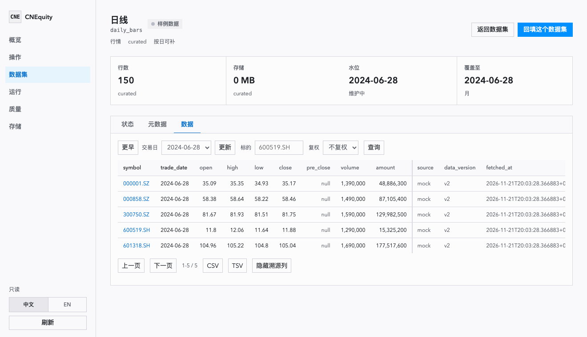
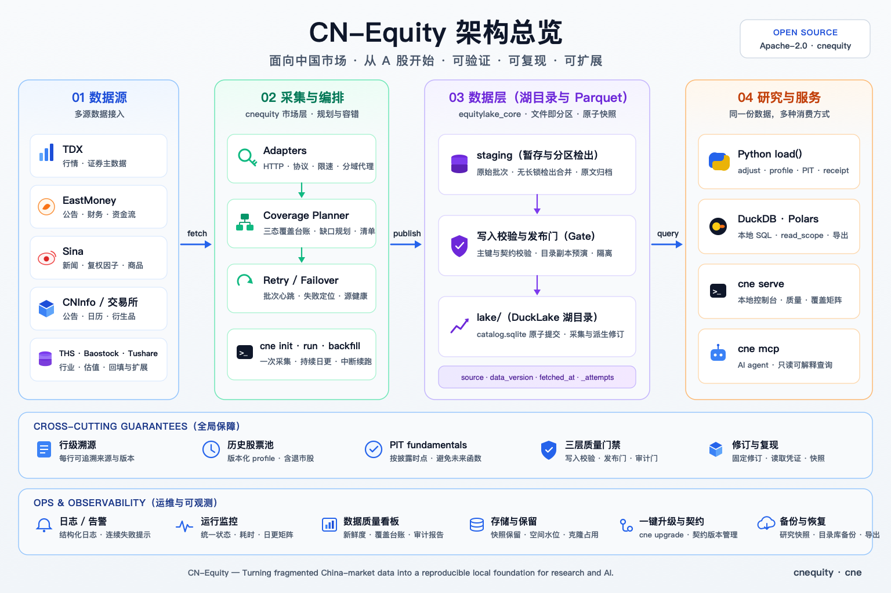

<div align="center">
  
  <h1>CNEquity · 中国市场金融数据湖</h1>
  <p>本地 Parquet · 增量更新 · 复权与时点查询 · 行级溯源 · MCP 原生</p>

CNEquity 是面向量化研究的中国市场本地数据湖。它把行情、财报、公司事件和资金流等数据整理到本地 Parquet，支持增量更新、行级溯源，以及 Python、SQL 和 MCP 查询。历史股票池、复权和时点查询有明确的数据口径与覆盖限制。

[](https://github.com/rootSunc/CNEquity/actions/workflows/ci.yml)
[](https://pypi.org/project/cnequity/)
[](docs/zh/getting-started/installation.md)
[](LICENSE)
[](https://github.com/rootSunc/CNEquity/stargazers)
[](https://glama.ai/mcp/servers/rootSunc/CNEquity)

[English](README.en.md) · [完整文档](https://rootsunc.github.io/CNEquity/) · [数据集目录](docs/zh/datasets/catalog.md) · [更新日志](CHANGELOG.md) · [发布记录](https://github.com/rootSunc/CNEquity/releases)
</div>



*`cne serve` 控制台。画面中的行情来自离线合成样例。*

## 为什么用 CNEquity

| 能力 | 在 CNEquity 中 |
|---|---|
| 账号与 Token | 基础采集不要求付费源凭证，部分数据集需要额外来源或凭证 |
| 数据落盘与增量 | 本地 Parquet，支持增量更新与续跑 |
| 历史股票池与时点财报 | 按日期读取历史证据，覆盖取决于来源和本地采集 |
| 行级溯源 | 通过 `source`、`data_version` 和 `fetched_at` 核对来源 |
| 研究与 AI 查询 | 提供 Python、SQL 和只读 MCP 接口 |

## 快速开始

需要 Python 3.11 或更高版本，支持 macOS、Linux 和 Windows。

**① 离线试用。** 在空的工作目录执行以下命令。样例使用合成数据，无需连接行情源。

```bash
python -m pip install cnequity
cne init --profile sample
cne query --config configs/cnequity.sample.toml --sql "SELECT symbol, trade_date, close, source FROM daily_bars ORDER BY trade_date DESC LIMIT 5"
cne serve --read-only --config configs/cnequity.sample.toml
```

**② 用 AI 查询样例湖。** 以 Claude Code 为例，把配置文件的绝对路径交给只读 MCP 服务。

```bash
claude mcp add cnequity -- cne mcp --config /abs/path/to/configs/cnequity.sample.toml
```

连接后可以问「样例湖里最新的日线是哪天？数据来源是什么？」其他客户端可参阅 [MCP 接入指南](https://rootsunc.github.io/CNEquity/reference/mcp/)。

**③ 开始采集真实数据。** `cne init --profile demo` 在独立演示湖中采集少量标的的日线。`cne init` 在配置的证券范围内建立约三年的主干数据，可用 `cne check` 验收。更深历史、配置和续跑方式见[快速开始](docs/zh/getting-started/quickstart.md)。

```python
from cnequity.query import load

bars = load("daily_bars", symbols=["600519.SH"])
print(bars.tail())
```

## 能用它研究什么

| 你的问题 | 数据与入口 |
|---|---|
| 跨分红、送转后的历史收益 | `daily_bars` + `adj_factors` · [行情与复权](https://rootsunc.github.io/CNEquity/datasets/query-guide/#prices-and-universe) |
| 调仓日已经知道哪些财报信息 | `financial_statement_items` · [财报的时点口径](https://rootsunc.github.io/CNEquity/datasets/query-guide/#pit) |
| 历史股票池、退市前行情 | `instruments`、`trading_status`、`delisting_events` · [历史股票池](https://rootsunc.github.io/CNEquity/datasets/query-guide/#prices-and-universe) |
| 估值、资金流和行业轮动 | `valuation_metrics`、资金面与结构数据 · [数据集目录](docs/zh/datasets/catalog.md) |
| 期货期限结构、期权链与 Greeks | 逐合约行情和派生数据 · [分钟线与衍生品](https://rootsunc.github.io/CNEquity/datasets/query-guide/#intraday-and-derivatives) |

## 数据范围

数据按研究用途分为 L0–L9。各数据集的支持档位、来源和历史限制见[数据集目录](docs/zh/datasets/catalog.md)，字段和单位见[数据字段](docs/zh/datasets/schema.md)。

| 层次 | 研究用途 | 代表数据集 |
|---|---|---|
| L0 | 基础参考 | 证券主数据、交易日历、交易状态 |
| L1 | 行情 | 日线、指数、复权因子、分钟线与分笔、退市事件 |
| L2 | 公司事件 | 公司行为、公告索引、业绩披露预约 |
| L3 | 基本面 | 财报、估值、股本、股东、一致预期 |
| L4 | 资金面 | 北向、融资融券、龙虎榜、大宗交易、资金流 |
| L5 | 行业结构 | 指数成分、行业与板块成分、行业指数 |
| L6 | 宏观 | 宏观指标、市场宽度 |
| L7 | 舆情与轮动 | 新闻、快讯、情绪、人气、板块行情与资金流 |
| L8 | 风险合规 | 解禁日程、监管事件 |
| L9 | 衍生品 | 期货与期权合约、逐合约行情、连续合约、Greeks、分钟线 |

## 架构



湖目录、写入发布、覆盖规划、质量门禁和版本复现的设计见[整体设计](docs/zh/architecture/overview.md)。

## 幸存者偏差

**回测时按研究日期选股票池。** 用今天仍上市的名单筛选历史，会丢掉当时已上市、后来退市的股票。历史上市、退市和 ST 状态都依赖当日证据。参见[行情与历史股票池](https://rootsunc.github.io/CNEquity/datasets/query-guide/#prices-and-universe)。

## 日常更新与升级

```bash
cne run daily
cne status --datasets
cne check
```

自动日更、缺口检查和补数见[日常更新](docs/zh/operations/runbook.md)，按症状定位问题见[故障排查](docs/zh/operations/troubleshooting.md)。升级前参阅[安装与升级](docs/zh/getting-started/installation.md)，核对目标版本的湖迁移和备份要求。

## 适合与边界

CNEquity 适合持续积累历史、反复查询和自托管。软件采用 [Apache-2.0](LICENSE)，数据适用各上游条款。详见[许可、来源与引用](docs/zh/legal-and-data-sources.md)。

## 文档与参与

| 想做什么 | 从这里开始 |
|---|---|
| 安装、跑通首个查询 | [安装与升级](docs/zh/getting-started/installation.md) · [快速开始](docs/zh/getting-started/quickstart.md) |
| 找数据、核对覆盖 | [数据集目录](docs/zh/datasets/catalog.md) · [字段与单位](docs/zh/datasets/schema.md) |
| 了解设计思路 | [整体设计](docs/zh/architecture/overview.md) |
| 用 Python、SQL、MCP 查询 | [查询与研究](docs/zh/datasets/query-guide.md) · [Python API](docs/zh/reference/python-api.md) · [MCP](docs/zh/reference/mcp.md) |
| 查命令、联网和写入行为 | [CLI 联网与写入清单](docs/zh/reference/cli-surface.md) |
| 配置、调度、处理失败 | [配置参考](docs/zh/getting-started/configuration.md) · [日常更新](docs/zh/operations/runbook.md) · [故障排查](docs/zh/operations/troubleshooting.md) |
| 提交问题或安全报告 | [求助方式](.github/SUPPORT.md) · [安全报告流程](SECURITY.md) |

反馈时请提供版本、命令和最小复现，去掉个人路径与凭证。研究引用见 [CITATION.cff](CITATION.cff)。

<!-- mcp-name: io.github.rootSunc/cnequity -->
