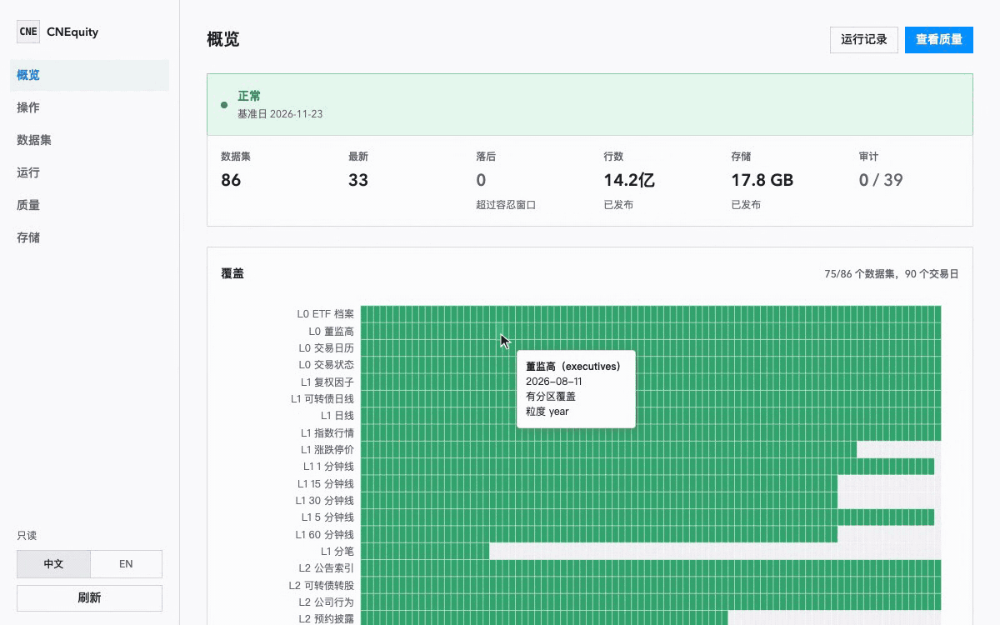
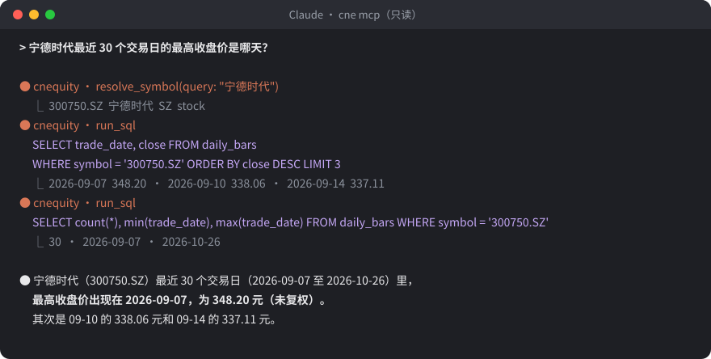
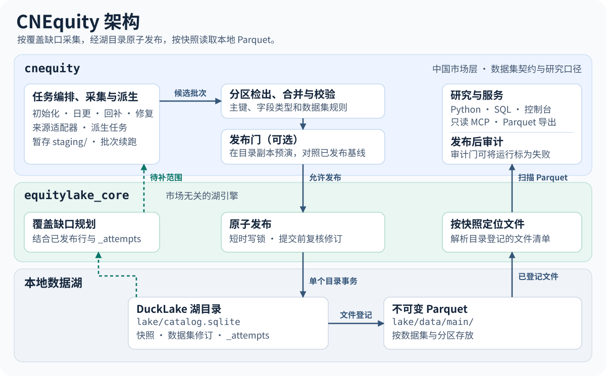
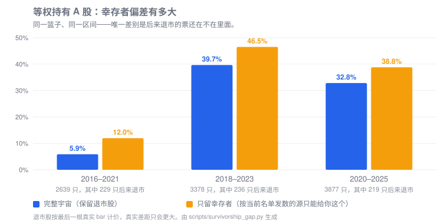

<!-- Generated from README.md by scripts/dev/sync_docs.py; edit README.md. -->

<div align="center">
  
  <h1>CNEquity · 中国市场金融数据湖</h1>
  <p>免注册、免 Token · 复权与 PIT 内置 · 保留退市股 · 行级溯源 · MCP 原生</p>

CNEquity 是开源的中国 A 股本地数据湖：整理沪深京股票行情、公司事件、财务与期货期权数据，面向量化研究、量化交易与回测。86 个数据集经 DuckLake 湖目录原子发布到本地 Parquet，支持按覆盖台账增量续跑，也能通过 MCP 让 AI 直接查 A 股。

[](https://github.com/rootSunc/CNEquity/actions/workflows/ci.yml)
[](https://pypi.org/project/cnequity/)
[](https://rootsunc.github.io/CNEquity/getting-started/installation/)
[](https://github.com/rootSunc/CNEquity/blob/main/LICENSE)
[](https://github.com/rootSunc/CNEquity/stargazers)
[](https://glama.ai/mcp/servers/rootSunc/CNEquity)

[English](https://github.com/rootSunc/CNEquity/blob/main/README.en.md) · [完整文档](https://rootsunc.github.io/CNEquity/) · [数据集目录](https://rootsunc.github.io/CNEquity/datasets/catalog/) · [更新日志](https://github.com/rootSunc/CNEquity/blob/main/CHANGELOG.md) · [发布记录](https://github.com/rootSunc/CNEquity/releases)
</div>



*`cne serve` 控制台录屏，使用覆盖 L0–L9 的离线合成样例数据。*

## 为什么用 CNEquity

和常用取数工具的区别（设计取舍见[整体设计](https://rootsunc.github.io/CNEquity/architecture/overview/#scope)）：

| | AKShare | Tushare Pro | Baostock | CNEquity |
|---|---|---|---|---|
| 账号与 Token | 不需要 | 注册 + Token，按积分开放 | 不需要，匿名登录 | 基础采集不需要；可选接入 Tushare 等付费源回填 |
| 数据落盘与增量 | 调用方自己做 | 调用方自己做 | 调用方自己做 | DuckLake 湖目录 + 文件即分区 Parquet，覆盖台账驱动增量与续跑 |
| 退市股与 PIT 财报 | 取决于接口 | 取决于接口 | 部分提供 | 版本化历史股票池保留退市股，财报按披露时点严格 PIT |
| 行级溯源与版本复现 | 无 | 无 | 无 | 每行带 `source`、`data_version`、`fetched_at`，支持固定修订与读取凭证 |
| 给 AI 用 | 自己封装 | 自己封装 | 自己封装 | `cne mcp` 只读接入 |

## 快速开始

需要 Python 3.11+（依赖 DuckDB 2.0+，支持 macOS / Linux / Windows），基础采集不需要账号或 token。小内存或小磁盘机器可先看[资源配置建议](https://rootsunc.github.io/CNEquity/getting-started/configuration/#small-machines)。

**① 一分钟试用。** 用真实数据源抓 5 只股票最近 30 个交易日，建在独立目录里，不影响以后的正式湖（离线环境可用 `cne init --profile sample` 生成合成样例湖）：

```bash
pip install cnequity
cne init --profile demo   # 约 1 分钟；结束时打印行情表、查询示例和接给 AI 的命令
cne serve --config configs/cnequity.demo.toml   # 在浏览器里打开上面的控制台
```

**② 让 AI 直接查 A 股。** 把湖以只读方式接给 Claude、ChatGPT、Codex、Gemini CLI、Cursor、VS Code 等支持 MCP 的客户端（`--config` 用绝对路径）。以 Claude Code 为例：

```bash
claude mcp add cnequity -- cne mcp --config /abs/path/to/configs/cnequity.demo.toml
```

各家客户端的写法见 [MCP 接入指南](https://rootsunc.github.io/CNEquity/reference/mcp/)；ChatGPT 只接公网网址，用 `cne mcp --http --token` 加隧道接入。然后直接问：「宁德时代最近 30 个交易日的最高收盘价是哪天？」



*真实 MCP 工具调用与返回；收盘价为未复权价。*

**③ 建正式湖。** 沪深京全市场、最近 3 年：

```bash
cne init     # 开始建正式湖，支持中断续跑
cne check    # 检查数据是否完整、可用
```

```python
from cnequity.query import load

bars = load("daily_bars", symbols=["600519.SH"])
print(bars.tail())
```

之后每天运行一次 `cne run daily` 保持更新。想要更长的历史（`cne init --profile full`），或了解 `init` 的范围与续跑方式，见[快速开始](https://rootsunc.github.io/CNEquity/getting-started/quickstart/#init-scope)。

## 能用它研究什么

| 你的问题 | 数据与入口 |
|---|---|
| 跨分红、送转后的历史收益 | `daily_bars` + `adj_factors` · [行情与复权](https://rootsunc.github.io/CNEquity/datasets/query-guide/#prices-and-universe) |
| 某个调仓日已经知道哪些财报信息 | `financial_statement_items` · [财报的时点口径](https://rootsunc.github.io/CNEquity/datasets/query-guide/#pit) |
| 历史股票池、退市前行情 | `instruments`、`trading_status`、`delisting_events` · [历史股票池与 `profile`](https://rootsunc.github.io/CNEquity/datasets/query-guide/#prices-and-universe) |
| 估值、资金流、行业轮动 | `valuation_metrics`、资金面与结构数据 · [查询与研究](https://rootsunc.github.io/CNEquity/datasets/query-guide/) |
| 期货期限结构、期权链与 Greeks | 逐合约行情和派生数据 · [分钟线与衍生品](https://rootsunc.github.io/CNEquity/datasets/query-guide/#intraday-and-derivatives) |

## 数据范围

支持 **86 个数据集**（78 个采集数据集、8 个派生数据集），按用途分为 L0–L9。支持档位、主键、历史起点和来源见[数据集目录](https://rootsunc.github.io/CNEquity/datasets/catalog/)与[字段与单位](https://rootsunc.github.io/CNEquity/datasets/schema/)。

| 层次 | 研究用途 | 代表数据集 |
|---|---|---|
| L0 | 基础参考 | 证券主数据、交易日历、交易状态、曾用名、可转债与高管资料 |
| L1 | 行情 | 日线、指数、可转债行情、涨跌停价、复权因子、可选分钟线与分笔、退市事件 |
| L2 | 公司事件 | 公司行为、公告索引、业绩预告与披露预约、股东增减持、股份回购、可转债转股与强赎 |
| L3 | 基本面 | 财报、主营构成、估值、股本、股东人数与十大股东、高管薪酬、一致预期与券商预测 |
| L4 | 资金面 | 北向资金与十大成交、融资融券、龙虎榜、游资名录与明细、涨停与连板天梯、筹码分布、大宗交易、资金流 |
| L5 | 结构行业 | 指数成分、行业与板块成分、行业指数 |
| L6 | 宏观 | 宏观指标、市场宽度 |
| L7 | 舆情与轮动 | 新闻、快讯、互动易问答、情绪、人气与最强板块、板块行情与资金流、财经日历 |
| L8 | 风险合规 | 股权质押、解禁日程、监管事件 |
| L9 | 衍生品 | 期货与期权合约、逐合约行情、商品日线、期货会员持仓、连续合约、Greeks、分钟线 |

分钟线、分笔、期货/期权，以及资金流、新闻、人气榜等[尽力而为与可选数据集](https://rootsunc.github.io/CNEquity/datasets/catalog/#coverage)默认关闭，需要时可在配置中打开。

## 架构



代码分为市场无关的湖引擎 `equitylake_core`（DuckLake 湖目录 `lake/catalog.sqlite`、文件即分区 Parquet、无长锁分区检出合并、覆盖台账 `_attempts` 与缺口规划器）与 A 股市场层 `cnequity`（L0–L9 契约、多源适配器、三层质量门禁、查询语义与 CLI）。外部工具需要直接读 Parquet 文件时使用 `cne storage export` 导出。详见[整体设计](https://rootsunc.github.io/CNEquity/architecture/overview/)。

## 幸存者偏差

**今天的名单不能代替历史股票池。** 回测时在 `load()` 中通过版本化股票池 `profile`（如 `cn_a_sh_sz_research_v1`）按研究日期筛选，避免丢掉当时已上市、后来退市的股票。



## 日常更新与升级

```bash
cne schedule install   # 为当前用户安装每日定时任务（macOS / Linux / Windows）
cne run daily          # 或者自己每天运行一次
cne check              # 验收；有缺口或质量 error 时返回非零
```

升级：`pip install -U cnequity`，然后运行 `cne upgrade`（先预览，确认后加 `cne upgrade --apply` 一步完成湖目录迁移；完整展开的旧配置可运行 `cne config upgrade`）。0.25.0 起湖目录成为唯一的存储方式，**0.25.x 是最后一个能升级 0.24.0 及更早湖的版本系列**。升级前请先备份数据目录并阅读[升级到 0.25.0](https://rootsunc.github.io/CNEquity/getting-started/upgrade-0.25/)。调度、操作页、磁盘占用（`cne storage usage`）和失败后续见[日常更新](https://rootsunc.github.io/CNEquity/operations/runbook/)。

## 适合与边界

适合持续积累历史、反复查询和自托管。

项目处于 **0.x**，不含回测引擎或下单。代码采用 [Apache-2.0](https://github.com/rootSunc/CNEquity/blob/main/LICENSE)，数据另受[上游许可](https://rootsunc.github.io/CNEquity/legal-and-data-sources/)约束，仓库不附带数据湖。

## 文档与参与

| 想做什么 | 从这里开始 |
|---|---|
| 安装、跑通首个查询或升级旧湖 | [安装与升级](https://rootsunc.github.io/CNEquity/getting-started/installation/) · [升级到 0.25.0](https://rootsunc.github.io/CNEquity/getting-started/upgrade-0.25/) · [快速开始](https://rootsunc.github.io/CNEquity/getting-started/quickstart/) |
| 找数据、确认口径 | [数据集目录](https://rootsunc.github.io/CNEquity/datasets/catalog/) · [字段与单位](https://rootsunc.github.io/CNEquity/datasets/schema/) · [查询与研究](https://rootsunc.github.io/CNEquity/datasets/query-guide/) |
| 用 Python、SQL、MCP 查询 | [Python API](https://rootsunc.github.io/CNEquity/reference/python-api/) · [MCP 接入](https://rootsunc.github.io/CNEquity/reference/mcp/) · [查询指南](https://rootsunc.github.io/CNEquity/datasets/query-guide/) |
| 查命令、配置和副作用 | [联网与写入清单](https://rootsunc.github.io/CNEquity/reference/cli-surface/) · [配置参考](https://rootsunc.github.io/CNEquity/getting-started/configuration/) |
| 配调度、处理失败 | [日常更新](https://rootsunc.github.io/CNEquity/operations/runbook/) · [故障排查](https://rootsunc.github.io/CNEquity/operations/troubleshooting/) |
| 理解整体设计与反馈问题 | [整体设计](https://rootsunc.github.io/CNEquity/architecture/overview/) · [升级与兼容性](https://rootsunc.github.io/CNEquity/getting-started/installation/#升级与兼容性) |

欢迎提交带最小复现的 [Issue](https://github.com/rootSunc/CNEquity/issues)、文档修正或数据适配 PR。研究引用见 [CITATION.cff](https://github.com/rootSunc/CNEquity/blob/main/CITATION.cff)；安全问题请按[安全策略](https://github.com/rootSunc/CNEquity/blob/main/SECURITY.md)私下报告。

**觉得有用？[点一个 Star](https://github.com/rootSunc/CNEquity)，或把项目分享给同样在维护 A 股数据的人。**

<!-- mcp-name: io.github.rootSunc/cnequity -->
