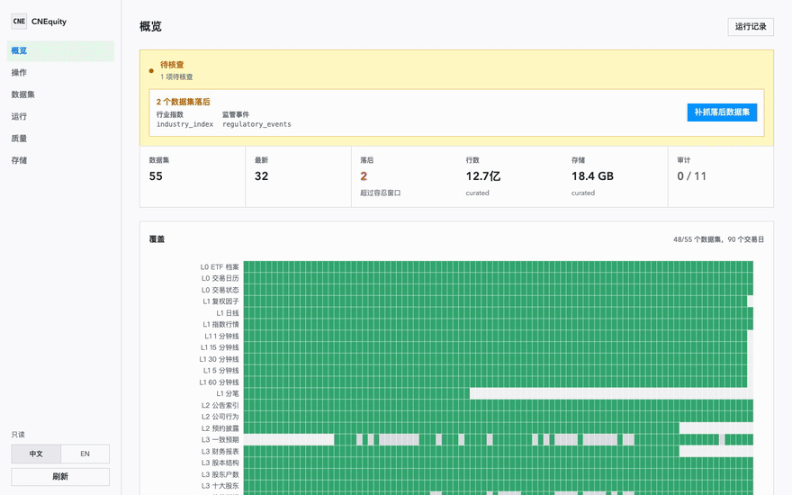
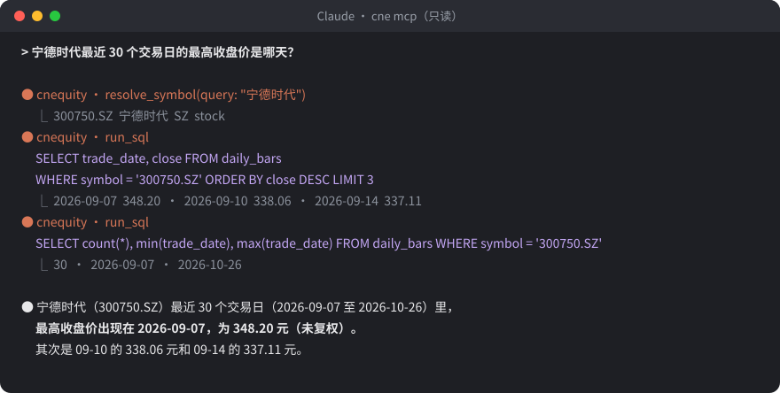
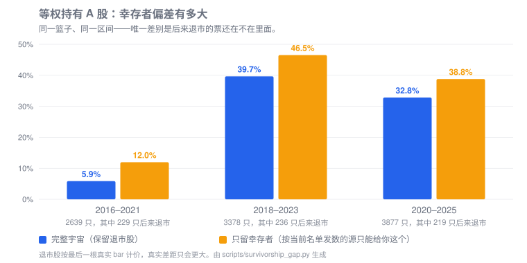

<!-- Generated from README.md by scripts/dev/sync_docs.py; edit README.md. -->

<div align="center">
  
  <h1>CNEquity · 中国市场金融数据湖</h1>
<p>免注册、免 Token · 复权与 PIT 内置 · 保留退市股 · 行级溯源 · MCP 原生</p>

CNEquity 是开源的中国 A股本地数据湖：整理沪深股票行情、股票数据、财务与期货数据，面向量化研究、量化交易与回测。57 个数据集落到本地 Parquet，可增量续跑，也能通过 MCP 让 AI 直接查 A 股。

[](https://github.com/rootSunc/CNEquity/actions/workflows/ci.yml)
[](https://pypi.org/project/cnequity/)
[](https://rootsunc.github.io/CNEquity/getting-started/installation/)
[](https://github.com/rootSunc/CNEquity/blob/main/LICENSE)
[](https://github.com/rootSunc/CNEquity/stargazers)
[](https://glama.ai/mcp/servers/rootSunc/CNEquity)

[English](https://github.com/rootSunc/CNEquity/blob/main/README.en.md) · [完整文档](https://rootsunc.github.io/CNEquity/) · [数据集目录](https://rootsunc.github.io/CNEquity/datasets/catalog/) · [更新日志](https://github.com/rootSunc/CNEquity/blob/main/CHANGELOG.md)
</div>



*`cne serve` 控制台真实录屏。*

## 为什么用 CNEquity

和常用取数工具的区别（完整说明见[对比页](https://rootsunc.github.io/CNEquity/architecture/comparison/)）：

| | AKShare | Tushare Pro | Baostock | CNEquity |
|---|---|---|---|---|
| 账号与 Token | 不需要 | 注册 + Token，按积分开放 | 不需要，匿名登录 | 基础采集不需要 |
| 数据落盘与增量 | 调用方自己做 | 调用方自己做 | 调用方自己做 | 本地 Parquet，内置增量与续跑 |
| 退市股与 PIT 财报 | 取决于接口 | 取决于接口 | 部分提供 | 保留退市股，财报按公告日严格 PIT |
| 行级溯源 | 无 | 无 | 无 | 每行带来源、版本和抓取时间 |
| 给 AI 用 | 自己封装 | 自己封装 | 自己封装 | `cne mcp` 只读接入 |

## 快速开始

需要 Python 3.10+（macOS / Linux / Windows），不需要账号或 token。

**① 一分钟试用。** 用真实数据源抓 5 只股票最近 30 个交易日，建在独立目录里，不影响以后的正式湖：

```bash
pip install cnequity
cne init --profile demo   # 约 1 分钟；结束时打印行情表、查询示例和接给 AI 的命令
cne serve --config configs/cnequity.demo.toml   # 在浏览器里打开上面的控制台
```

**② 让 AI 直接查 A 股。** 把湖以只读方式接给 Claude、ChatGPT、Codex、Gemini CLI、Cursor、VS Code 等支持 MCP 的客户端（`--config` 用绝对路径）。以 Claude Code 为例：

```bash
claude mcp add cnequity -- cne mcp --config /abs/path/to/configs/cnequity.demo.toml
```

各家客户端的写法见 [MCP 接入指南](https://rootsunc.github.io/CNEquity/reference/mcp/#接入各家客户端)；ChatGPT 只接公网网址，用 `cne mcp --http --token` 加隧道接入。然后直接问：「宁德时代最近 30 个交易日的最高收盘价是哪天？」



*真实 MCP 工具调用与返回；收盘价为未复权价。*

**③ 建正式湖。** 沪深京全市场、最近 3 年：

```bash
cne init     # 开始建正式湖，支持中断续传
cne check    # 检查数据是否完整、可用
```

```python
from cnequity.query import load

bars = load("daily_bars", symbols=["600519.SH"])
print(bars.tail())
```

之后每天运行一次 `cne run daily` 保持更新。想要更长的历史，或了解 `init` 具体做了什么，见[初始化指南](https://rootsunc.github.io/CNEquity/getting-started/initialization/)。

## 能用它研究什么

| 你的问题 | 数据与入口 |
|---|---|
| 跨分红、送转后的历史收益 | `daily_bars` + `adj_factors` · [复权示例](https://rootsunc.github.io/CNEquity/recipes/research-baseline/) |
| 某个调仓日已经知道哪些财报信息 | `financial_statement_items` · [PIT 示例](https://rootsunc.github.io/CNEquity/recipes/pit-rebalance/) |
| 历史股票池、退市前行情 | `instruments`、`trading_status`、`delisting_events` · [股票池画像](https://rootsunc.github.io/CNEquity/reference/universe-profiles/) |
| 估值、资金流、行业轮动 | `valuation_metrics`、资金面与结构数据 · [查询指南](https://rootsunc.github.io/CNEquity/datasets/query-guide/) |
| 期货期限结构、期权链与 Greeks | 逐合约行情和派生数据 · [衍生品指南](https://rootsunc.github.io/CNEquity/recipes/derivatives/) |

## 数据范围

支持 **57 个数据集**（49 个 curated、8 个 derived），按用途分为 L0–L9。字段、主键、历史起点和来源见[数据集目录](https://rootsunc.github.io/CNEquity/datasets/catalog/)与[数据源说明](https://rootsunc.github.io/CNEquity/datasets/sources/)。

| 层次 | 研究用途 | 代表数据集 |
|---|---|---|
| L0 | 基础参考 | 证券主数据、交易日历、交易状态 |
| L1 | 行情 | 日线、指数、复权因子、可选分钟线与分笔、退市事件 |
| L2 | 公司事件 | 公司行为、公告索引、业绩披露预约 |
| L3 | 基本面 | 财报、估值、股本、股东、一致预期 |
| L4 | 资金面 | 北向、融资融券、龙虎榜、大宗交易、资金流 |
| L5 | 结构行业 | 指数成分、行业与板块成分、行业指数 |
| L6 | 宏观 | 宏观指标、市场宽度 |
| L7 | 舆情与轮动 | 新闻、快讯、情绪、人气、板块行情与资金流 |
| L8 | 风险合规 | 解禁日程、监管事件 |
| L9 | 衍生品 | 期货与期权合约、逐合约行情、连续合约、Greeks、分钟线 |

分钟线、分笔、期货/期权，以及资金流、新闻、人气榜等[拓展数据集](https://rootsunc.github.io/CNEquity/datasets/catalog/#支持档位)默认关闭，需要时用户自行打开。

## 架构


## 幸存者偏差

**今天的名单不能代替历史股票池。**



## 日常更新与升级

```bash
cne schedule install   # 为当前用户安装每日定时任务（macOS / Linux / Windows）
cne run daily          # 或者自己每天运行一次
cne check              # 验收；有缺口或质量 error 时返回非零
```

升级：`pip install -U cnequity`，然后 `cne config upgrade` 和 `cne migrate`（先预览，确认后加 `--apply`）。调度、操作页和失败后续见[日常运维](https://rootsunc.github.io/CNEquity/operations/runbook/)，范围与续跑见[初始化指南](https://rootsunc.github.io/CNEquity/getting-started/initialization/)。

## 适合与边界

适合持续积累历史、反复查询和自托管。

项目处于 **0.x**，不含回测引擎或下单。代码采用 [Apache-2.0](https://github.com/rootSunc/CNEquity/blob/main/LICENSE)，数据另受[上游许可](https://rootsunc.github.io/CNEquity/legal-and-data-sources/)约束，仓库不附带数据湖。

## 文档与参与

| 想做什么 | 从这里开始 |
|---|---|
| 安装、跑通首个查询 | [安装](https://rootsunc.github.io/CNEquity/getting-started/installation/) · [快速开始](https://rootsunc.github.io/CNEquity/getting-started/quickstart/) |
| 常见问题 | [免费获取 A股历史数据](https://rootsunc.github.io/CNEquity/guides/free-a-share-data/) · [回测避免未来函数](https://rootsunc.github.io/CNEquity/guides/avoid-look-ahead-bias/) · [用 AI 查 A股](https://rootsunc.github.io/CNEquity/guides/ai-query-a-shares/) · [与 AKShare、Tushare、Baostock 对比](https://rootsunc.github.io/CNEquity/architecture/comparison/) |
| 找数据、确认口径 | [目录](https://rootsunc.github.io/CNEquity/datasets/catalog/) · [字段](https://rootsunc.github.io/CNEquity/datasets/schema/) · [研究示例](https://rootsunc.github.io/CNEquity/recipes/) |
| 查命令、参数和副作用 | [CLI](https://rootsunc.github.io/CNEquity/reference/cli/) · [参数默认值](https://rootsunc.github.io/CNEquity/reference/cli-options/) · [联网与写入清单](https://rootsunc.github.io/CNEquity/reference/cli-surface/) |
| 配调度、处理失败 | [运行手册](https://rootsunc.github.io/CNEquity/operations/runbook/) · [取数与源保护](https://rootsunc.github.io/CNEquity/operations/fetch-policy/) · [排障](https://rootsunc.github.io/CNEquity/operations/troubleshooting/) |
| 理解产品方向与反馈问题 | [产品设计](https://rootsunc.github.io/CNEquity/architecture/overview/) · [升级与反馈](https://rootsunc.github.io/CNEquity/getting-started/installation/#升级与兼容性) |

欢迎提交带最小复现的 [Issue](https://github.com/rootSunc/CNEquity/issues)、文档修正或数据适配 PR。研究引用见 [CITATION.cff](https://github.com/rootSunc/CNEquity/blob/main/CITATION.cff)；安全问题请按[安全策略](https://github.com/rootSunc/CNEquity/blob/main/SECURITY.md)私下报告。

**觉得有用？[点一个 Star](https://github.com/rootSunc/CNEquity)，或把项目分享给同样在维护 A 股数据的人。**

<!-- mcp-name: io.github.rootSunc/cnequity -->
