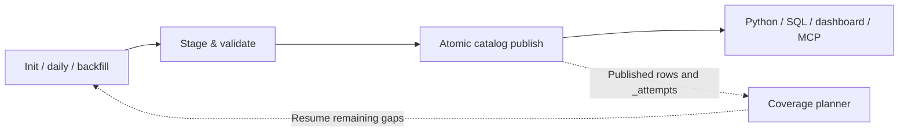

# CNEquity

A local China-market data lake for quantitative research. Collect prices, financial statements, corporate events, and flows according to your configuration, then publish them to local Parquet. Inspect coverage and research semantics, and resume unfinished collection.



## 30-second offline tryout {#try-offline}

Run an offline query against a synthetic sample lake in an empty directory—no credentials or network required:

```bash
python -m pip install cnequity
cne init --profile sample
cne query --config configs/cnequity.sample.toml --sql "SELECT symbol, trade_date, close, source FROM daily_bars ORDER BY trade_date DESC LIMIT 5"
```

## Explore by goal {#navigation}

<div class="grid cards" markdown>

-   **Getting started & upgrades**

    ---

    Move from the offline sample to live collection scopes, or upgrade an existing lake.

    - [Quickstart](getting-started/quickstart.md) · `sample`, `demo`, `quick`, and `full` scopes plus the local dashboard
    - [Install and upgrade](getting-started/installation.md) · System requirements and `cne upgrade` catalog migration steps

-   **Query & quantitative research**

    ---

    Control price adjustments, versioned historical universes, and point-in-time (PIT) financial semantics explicitly.

    - [Query guide](datasets/query-guide.md) · Adjustments, historical universes, PIT financials, intraday resampling, and Parquet export
    - [Python API](reference/python-api.md) · `load()`, `load_with_receipt()`, `scan()`, and `load_profile()`
    - [MCP](reference/mcp.md) · Connect the lake as read-only tools for Claude, ChatGPT, Cursor, and other AI agents

-   **Design & data dictionary**

    ---

    Understand catalog transactions, the coverage ledger, and every L0–L9 dataset's source limits and schema.

    - [Design](architecture/overview.md) · Lake catalog, publication gate, coverage planning, locks, and reproducibility
    - [Dataset catalog](datasets/catalog.md) · L0–L9 support tiers, primary/backfill sources, and historical limits
    - [Fields and units](datasets/schema.md) · Column names, types, units (such as shares vs. lots), and domain semantics

-   **Operations & compliance**

    ---

    Schedule daily updates, troubleshoot provider rate limits or audit findings, and review upstream data terms.

    - [Daily updates](operations/runbook.md) · Timers, run statuses, gap backfills, and snapshots
    - [Troubleshooting](operations/troubleshooting.md) · Symptom-driven guide for publishing, locks, rate limits, and audits
    - [Configuration](getting-started/configuration.md) · `extends = "builtin"`, credentials, and section reference
    - [Commands and side effects](reference/cli-surface.md) · Network and write boundaries for every CLI command
    - [License, sources, and citation](legal-and-data-sources.md) · Apache-2.0 license, upstream source matrix, and citation

</div>

See [GitHub Releases](https://github.com/rootSunc/CNEquity/releases) for release history. Run `cne --version` to identify your installed version.
