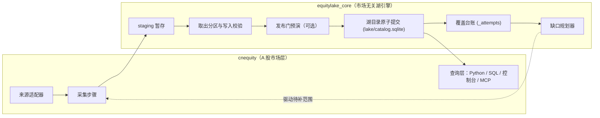

# 整体设计

CNEquity 是一个在本机运行的中国市场研究数据湖：持续从公开或自有授权的来源采集，统一口径后存成开放的 Parquet，再通过 Python、SQL、控制台和只读 MCP 查询。本页说明它的设计取舍和各部分如何配合。具体用法见各页链接。项目方向与功能范围由维护者统一规划，用户可以通过 Issue 反馈场景和问题。

## 适用范围 {#scope}

| 需求 | 是否适合 |
|---|---|
| 同一份历史数据反复用于多项研究，需要知道它从哪来、覆盖到哪、何时改过 | 主要用途 |
| 偶尔取一个报价或一张表 | 直接用来源的 API 更省事 |
| 需要供应商授权或服务承诺的数据 | 公共来源采集不能替代授权或 SLA |
| 回测、模型训练、交易执行 | 湖可以作为输入，策略和执行由下游负责 |
| 让 AI agent 查历史数据 | `cne mcp` 提供只读工具 |

安装不附带市场数据。磁盘、调度和上游可达性由使用者承担；快照类数据只能从启用那天起积累；代码许可不授予上游数据的再分发权，见[许可与来源](../legal-and-data-sources.md)。

## 设计原则 {#principles}

- **如实描述质量。** 免费来源的缺口是常态。缺失写成 `NULL`、休市不补造行情、来源失败保留旧数据并把运行标为 `degraded`；不用空表、默认值或当前状态冒充核实过的历史。
- **数据在用户手里。** 数据是本地开放格式，常用分析工具都能读；采集范围、来源和调度由配置决定。
- **研究口径可检查。** 原始价格与复权因子分开存；历史股票池、PIT 与复权各有证据要求，证据不足时严格查询会拒绝返回，而不是悄悄降级。
- **纠错可追溯。** 已发布的数据不原地修改，修正发布成新修订；固定修订、研究快照和读取凭证让结果可以复现。
- **可恢复。** 任何一步失败都不破坏已发布数据；续跑从停下的地方继续。

## 组成 {#components}

代码分两层。`equitylake_core` 是与市场无关的湖引擎：湖目录、写入、覆盖台账、规划器和锁，不引用任何市场代码。`cnequity` 是 A 股市场包：数据集登记、来源适配器、调度、质量检查、查询口径和 CLI。

数据集按研究用途分成 L0–L9（基础参考、行情、公司事件、基本面、资金面、结构行业、宏观、舆情、风险合规、衍生品），每个数据集有登记的主键、列类型、单位、分区方式和历史能力（`by_date`、`snapshot_with_backfill`、`snapshot_only`）。清单与来源见[数据与覆盖](../datasets/catalog.md)，契约随版本存在 `contracts/`。

## 湖目录与存储 {#lake-layout}

湖的根目录由 `[data].root` 决定：

| 路径 | 内容 |
|---|---|
| `lake/catalog.sqlite` | 湖目录库：哪些文件属于哪个快照、每个数据集的修订、覆盖台账 |
| `lake/data/main/<数据集>/<分区>/` | 已发布的 Parquet 数据文件 |
| `staging/` | 采集中的批次和发布前取出的分区；失败续跑依赖它 |
| `_quarantine/` | 被发布门拦下的候选分区和被隔离的行，供检查 |
| `meta/` | 运行清单（`manifest.db`）、迁移记录（`lake.json`）、调度标记、续跑点、来源缓存与裁决、质量报告、原始响应归档、快照和锁 |
| `duckdb/` | SQL 视图库 |
| `logs/`、`backups/` | 命令日志；元数据备份的默认位置 |

湖目录使用 DuckLake 格式，目录库是 SQLite。**每次提交是一个快照**，快照号就是整个湖的版本：读者固定一个快照号，就得到一组一致的表。

存储方式是「文件即分区」：一个文件只属于一个分区，目录名就是分区值，文件按主键排序写出，写成后不再改动。发布只登记新写的文件、整文件删除被替换的旧文件；取出分区用硬链接，不复制。外部工具不要直接读 `lake/data`，用 `cne storage export` 导出一份独立的 Parquet。

## 写入与发布 {#write-path}

一次运行的数据从采集到可读要经过：

1. **采集**。适配器按计划请求来源，结果按批次落到 `staging/`。批次有心跳；崩溃或失败的批次留给 `cne run retry` 续跑，已成功的批次不重拉。
2. **取出与合并**。把要改的分区从湖目录取出到 `staging/_checkout/<run_id>`，与新行合并、去重。同一主键按证据类别、`fetched_at` 先后和来源优先级保留一行；PIT 数据保留各个版本。
3. **写入校验**。主键为空、类型不符、非有限数值、违反登记规则（如 `high < low`）的行不写入；多数数据集整批拒绝，少数（衍生品行情、北交所涨跌停越界等）按行隔离到 `_quarantine/`。来源的缺失占位按数据集的取值规则转成 `NULL`。
4. **发布门**（可选，`[quality].publication_gate`）。把本次要改的分区登记进湖目录库的一份副本，审计这份副本，与已提交的基线比较。出现新增或加重的 `error` 时，逐个去掉候选数据集重新预演，只拦下造成问题的那个。
5. **提交**。在一个目录事务里替换变化的分区、写修订记录和覆盖答复。读者要么看到全部，要么什么也看不到。

只有提交这一小段持湖锁；读取、合并和发布门都不持锁。提交前会复核：取出时的基础修订、写入方声明依赖的输入修订、规划时读过的修订都没有被别的写入改动。有任何一项变了就拒绝提交，已发布数据不变，重跑即可。

数据集分别发布，不提供跨整个湖的长事务；同一次运行的数据集在同一个快照里提交。

## 覆盖与规划 {#coverage}

数据集的时间被切成格子（交易日、自然日、周、月、季、年，必要时再按证券切）。每个格子的三种状态：

- **应有**：由登记的切法、交易日历和证券范围推出；`[datasets.history_from]`、`[datasets.history_until]` 可以收窄这个湖的历史边界。
- **已有**：每次从已发布的行现算，不另存一份可能不一致的副本。水位也是这样算出来的。
- **问过且为空 / 只答了一部分**：已有的行证明不了「没有」，所以记进覆盖台账 `_attempts`，与数据在同一快照提交。为空的回答过了确认期才算数；只答了一部分的格子仍算欠着。

建湖、日更、回补和修复问的是同一个问题：这个范围里哪些格子应有却还没有。规划器只读湖、不发请求，把缺口交给来源去取。所以中断后重跑同一条命令就能接着补，`cne backfill` 默认跳过已覆盖或已确认为空的日子。

## 质量 {#quality}

质量分三层，各管一件事：

| 层 | 时机 | 失败时 |
|---|---|---|
| 写入校验 | 每次写入 | 问题行不进入湖 |
| 发布门 `publication_gate` | 提交前，审计候选数据 | `block` 时拒绝新增或加重的错误；`shadow` 只记录；默认 `off` |
| 审计门 `audit_gate` | 发布后，`cne audit` / `cne check` | 只决定运行状态：`block` 让运行失败，不撤回已发布数据；默认 `shadow` |

检查结果带 `info`、`warning`、`error` 严重度，写在 `meta/quality/`。跨来源比对（例如与交易所自己发布的收盘价对照）报告差异，不改写数据行。数据行的溯源列是 `source`、`data_version`、`fetched_at`；没有行级质量等级。新鲜、覆盖完整和口径正确是三个独立的检查项：最大日期新鲜不代表历史完整。

## 修订、保留与复现 {#revisions}

每个数据集的每次发布产生一个修订（修订号和修订 id），记在湖目录里。读取时可以用 `revision` 或 `revision_map` 固定各依赖数据集的修订；`load_with_receipt()` 返回这次读取实际用到的修订和数据范围。见[Python API](../reference/python-api.md)。

`cne backfill` 和 `cne run daily` 结束时，每个数据集保留最近 `keep_generations` 个修订（默认 5）中、`keep_days` 天内（默认 7）当过当前修订的那些，`cne storage hold` 登记过的修订一直保留。湖目录的快照是全湖共享的：一个修订从发布起到它的表下一次变化之间的任一快照都能读它，保留时让尽量多的修订共用同一个较新的快照，只留这些快照。被清理的修订仍有记录，但再读会明确失败，不会改读更新的修订。正在进行的长查询、导出和快照创建期间，清理会避开它们读着的文件；Python 的延迟扫描用 `read_scope()` 保护。

长期复现保存研究快照（`cne snapshot create --research`），连同查询参数、配置和软件版本。快照不含凭证。

## 并发与锁 {#locks}

| 锁 | 用途 |
|---|---|
| 运行锁（`meta/locks/`） | 同一类任务同时只跑一个：日更与事件流各用一把，所以晚间批处理和事件流可以并行 |
| 写入锁（`lake/write.lock`） | 提交修订时持有 |
| 维护锁（`lake/maintenance.lock`） | 托管的读写共享持有；升级等需要湖空闲的操作独占持有 |
| 文件锁（`lake/readers.lock`、`snapshot-locks/`） | 读者共享持有，保留清理只在没有读者时删除文件 |
| 调度锁（`locks/`） | 定时任务和控制台操作页共用 |

锁由操作系统持有，进程退出即释放。锁文件存在不代表仍有进程持锁，不要靠删锁文件恢复运行。

## 运行与状态 {#runs}

运行、批次、步骤和数据集结果统一使用一套状态：`running`、`success`、`degraded`、`failed`、`skipped`、`blocked`、`interrupted`、`superseded`（批次另有 `queued`、`stale`）。`degraded` 表示结果可用，但没有覆盖要求的全部范围；跳过的原因写在 `reason_code`（如 `non_trading_day`、`not_scheduled`、`locked`、`disabled`）。`success`、`degraded` 和这些跳过的退出码都是 0。

日更按调度组和依赖顺序执行，日更结束后跑事件流（公告、新闻）。事件流不看交易日历。`cne schedule install` 安装系统定时任务，交易日日更后运行维护（审计、元数据备份、保留清理）。见[日常更新](../operations/runbook.md)。

## 查询口径 {#query}

`load()` 负责研究语义：复权（`qfq`、`hfq`、`total_return`）、版本化的历史股票池（`profile`）、PIT（`as_of` 与 `pit_mode`）和严格证据校验。`scan()` 和 SQL 读原始字段，不自动套这些规则。控制台给人看湖并发起白名单内的任务；MCP 给模型用，只读。见[查询与研究](../datasets/query-guide.md)。
