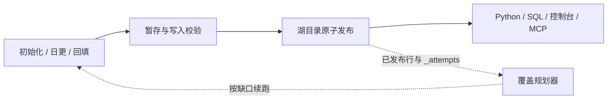

# CNEquity

面向中国市场量化研究的本地数据湖。按配置采集行情、财报、公司事件和资金流等数据，发布到本地 Parquet。数据源覆盖和研究口径可以查证，未完成的采集可续跑。



## 30 秒离线体验 {#try-offline}

无需数据源凭证或联网，先在空目录生成离线合成样例湖并执行第一条查询：

```bash
python -m pip install cnequity
cne init --profile sample
cne query --config configs/cnequity.sample.toml --sql "SELECT symbol, trade_date, close, source FROM daily_bars ORDER BY trade_date DESC LIMIT 5"
```

## 按目标进入文档 {#navigation}

<div class="grid cards" markdown>

-   **快速上手与升级**

    ---

    从离线样例切换到真实采集范围，或将已有数据湖升级到新版本。

    - [快速开始](getting-started/quickstart.md) · `sample`、`demo`、`quick`、`full` 采集范围与控制台预览
    - [安装与升级](getting-started/installation.md) · 系统要求与 `cne upgrade` 湖目录迁移步骤

-   **查询与量化研究**

    ---

    在回测与研究中显式控制复权、版本化历史股票池与财报时点（PIT）口径。

    - [查询指南](datasets/query-guide.md) · 行情复权、历史股票池、PIT 财报、分钟重采样与 Parquet 导出
    - [Python API](reference/python-api.md) · `load()`、`load_with_receipt()`、`scan()`、`load_profile()`
    - [MCP 接入](reference/mcp.md) · 把本地数据湖以只读工具接给 Claude、ChatGPT、Cursor 等 AI Agent

-   **架构设计与数据字典**

    ---

    了解湖目录事务、三态覆盖台账与 L0–L9 全部数据集的来源边界和字段定义。

    - [整体设计](architecture/overview.md) · 湖目录、写入发布门、覆盖规划、并发锁与版本复现
    - [数据集目录](datasets/catalog.md) · L0–L9 数据集支持档位、主备来源与历史深度限制
    - [字段与单位](datasets/schema.md) · 各数据集列名、类型、量纲单位（如股 vs 手）与特殊语义

-   **日常运维与合规**

    ---

    配置每日定时增量更新、排查数据源限流或审计告警，并核对上游数据使用边界。

    - [日常更新](operations/runbook.md) · 定时任务、运行状态解读、缺口回填与快照备份
    - [故障排查](operations/troubleshooting.md) · 按报错与症状定位发布、锁、限流与审计问题
    - [配置参考](getting-started/configuration.md) · `extends = "builtin"`、凭证管理与各配置段说明
    - [命令与副作用](reference/cli-surface.md) · 全部 CLI 命令的联网与本地写入边界
    - [许可、来源与引用](legal-and-data-sources.md) · 代码许可、上游数据合规矩阵与学术引用

</div>

发布历史见 [GitHub Releases](https://github.com/rootSunc/CNEquity/releases)。用 `cne --version` 确认已安装的版本。
